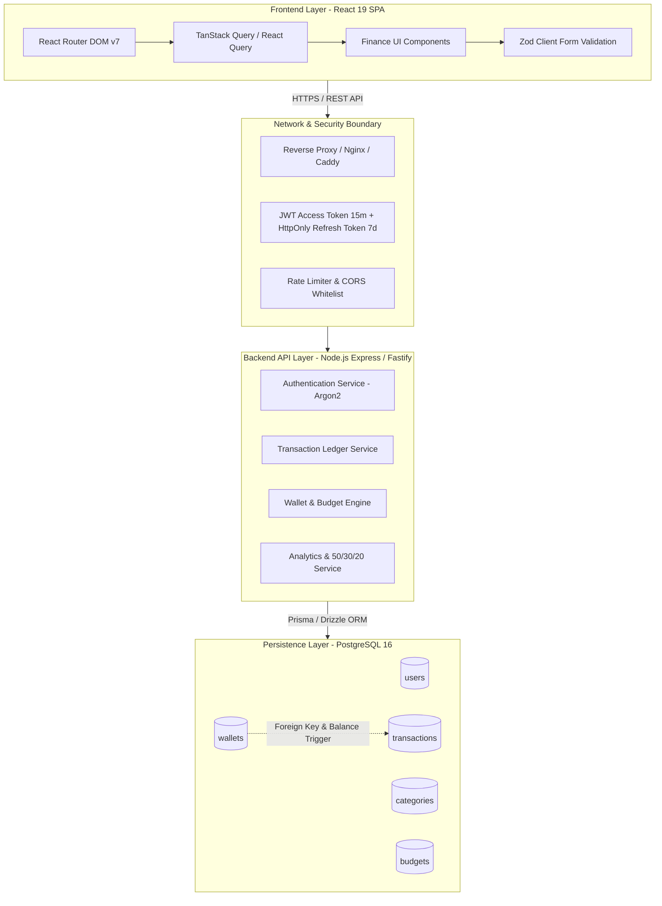

# LAPORAN AUDIT MENYELURUH SISTEM KEUANGAN PERSONAL FINTRACK
**Dokumen Audit Resmi & Rencana Rekayasa Perangkat Lunak**  
*Tanggal Pelaksanaan Audit*: 11 Oktober 2026  
*Auditor*: Senior Full-Stack Software Engineer, Software Architect & Security Auditor  
*Status Audit*: Selesai (Analisis Statis, Kode Sumber, Eksekusi Lint & Build Terverifikasi)

---

## 1. RINGKASAN EKSEKUTIF

Proyek **FinTrack** saat ini merupakan aplikasi **Single Page Application (SPA) Client-Side murni** berbasis **React 19** dan **Vite 8**. Berdasarkan audit komprehensif terhadap seluruh basis kode, repositori git, konfigurasi build, dan dependensi, ditemukan bahwa project ini berada pada **tahap akhir prototipe Frontend MVP** dan **belum memiliki Backend maupun Database sama sekali**.

### Ringkasan Status Keseluruhan:
1. **Frontend**: Antarmuka pengguna (UI) sudah terbangun dengan rapi menggunakan Vanilla CSS modern, Recharts, dan Lucide Icons. Namun, terdapat **31 error linting ESLint**, *bundle size* yang melebihi batas 500 kB (656 kB), routing berbasis state internal tanpa URL route, dan tidak adanya fitur edit transaksi serta konfirmasi hapus.
2. **Backend**: **0% (Belum Dibuat)**. Tidak ditemukan server runtime (Express, Fastify, Go, dsb.), routing API, middleware autentikasi, controller, maupun skrip server.
3. **Database**: **0% (Belum Dibuat)**. Tidak ditemukan basis data relasional (PostgreSQL/MySQL), ORM (Prisma/Drizzle), skema migrasi, indeks, maupun koneksi database. Penyimpanan saat ini 100% mengandalkan `localStorage` browser.
4. **Kalkulasi Finansial**: Ditemukan **kejanggalan kalkulasi kritis**, antara lain:
   - Nilai saldo bersih ditambahkan angka ajaib (*magic number*) `+ Rp 5.000.000` tanpa sumber dana yang valid.
   - Daftar Dompet/Rekening bersifat statis dan **tidak pernah sinkron** dengan mutasi transaksi.
   - Pengeluaran kategori *Edukasi* tidak dihitung dalam rasio Aturan 50/30/20.
   - Filter periode waktu (*periodFilter*) tidak berfungsi dalam perhitungan metrik dashboard.
5. **Kesiapan Produksi**: Belum siap produksi (*not production-ready*). Dibutuhkan penuntasan perbaikan fondasi frontend, pembuatan REST API backend, perancangan skema PostgreSQL, dan pengamanan multi-user.

---

## 2. INFORMASI PROJECT DAN LINGKUP AUDIT

### A. Informasi Proyek
- **Nama Proyek**: FinTrack (Personal Finance Management System)
- **Lokasi Direktori**: `d:\month-4\project-keuwangan\fintrack`
- **Cabang Git Aktif**: `main` (Commit tunggal: `8fa3afc feat: initial project setup`)
- **Tipe Aplikasi**: Client-side Web Application (React SPA)
- **Port Development Aktif**: `http://localhost:5173` (Vite Dev Server)

### B. Lingkup Audit
Audit mencakup:
1. Pemeriksaan 100% berkas sumber dalam direktori `src/`, berkas konfigurasi root (`vite.config.js`, `eslint.config.js`, `package.json`, `index.html`), serta dokumentasi internal (`README.md`, `BACKLOG.md`, `SPRINT_30_DAYS.md`).
2. Analisis statis logika bisnis, alur data, hook React, state management, dan persistensi `localStorage`.
3. Pemeriksaan integritas kalkulasi keuangan dan representasi data moneter.
4. Pengujian eksekusi perintah build (`npm run build`) dan linter (`npm run lint`).
5. Audit keamanan aplikasi (autentikasi, enkripsi, isolasi tenant, dan penyimpanan rahasia).
6. Identifikasi dead code, redundant files, dan arsitektur yang menghambat skalabilitas.

---

## 3. STRUKTUR DIREKTORI & INVENTARIS BERKAS

Berikut adalah inventarisasi lengkap direktori dan file proyek FinTrack berdasarkan kondisi aktual di disk:

| Path Berkas / Direktori | Fungsi & Tanggung Jawab | Status Penggunaan | Kelengkapan Implementasi | Masalah Ditemukan | Rekomendasi Tindakan |
|---|---|---|---|---|---|
| `fintrack/index.html` | Entry point HTML, font loader, metadata SEO | **Aktif Digunakan** | Lengkap | - | Pertahankan |
| `fintrack/vite.config.js` | Konfigurasi bundler Vite & path alias `@/` | **Aktif Digunakan** | Lengkap | Belum ada manual chunk splitting | Perbaiki (tambahkan chunk splitting) |
| `fintrack/eslint.config.js` | Konfigurasi ESLint flat config | **Aktif Digunakan** | Lengkap | Rule `no-unused-vars` menyebabkan 31 error | Pertahankan & perbaiki kode sumber |
| `fintrack/package.json` | Manifest dependensi & skrip npm | **Aktif Digunakan** | Parsial | Tidak ada dependensi testing dan router | Perbaiki (tambah dependensi esensial) |
| `fintrack/package-lock.json` | Lockfile dependensi npm | **Aktif Digunakan** | Lengkap | - | Pertahankan |
| `fintrack/.gitignore` | Daftar abaikan git | **Aktif Digunakan** | Lengkap | Tidak mengabaikan `.env` secara eksplisit | Perbaiki (tambahkan `.env*`) |
| `fintrack/README.md` | Dokumentasi ringkas proyek | **Aktif Digunakan** | Lengkap | Klaim fitur mendahului status backend | Perbarui dokumentasi |
| `fintrack/BACKLOG.md` | Backlog produk dan engineering | **Dokumentasi** | Lengkap | Belum ter-commit ke git | Pertahankan & commit ke git |
| `fintrack/SPRINT_30_DAYS.md` | Jadwal sprint 30 hari | **Dokumentasi** | Lengkap | Belum ter-commit ke git | Pertahankan & commit ke git |
| `fintrack/components/Sidebar.jsx` | Re-export `../src/components/Sidebar` | **Redundant (Dead)** | 1 baris re-export | Terletak di luar folder `src/` | **Hapus direktori root `components/`** |
| `fintrack/pages/Dashboard.jsx` | Re-export `../src/pages/Dashboard` | **Redundant (Dead)** | 1 baris re-export | Terletak di luar folder `src/` | **Hapus direktori root `pages/`** |
| `fintrack/data/` | Direktori kosong di root | **Tidak Digunakan** | Kosong (0 bytes) | Folder tidak sengaja terbuat di root | **Hapus direktori root `data/`** |
| `fintrack/public/favicon.svg` | Ikon SVG aplikasi | **Aktif Digunakan** | Lengkap | - | Pertahankan |
| `fintrack/public/icons.svg` | Sprite icon SVG | **Tidak Digunakan** | Statis | Tidak direferensikan dalam kode React | Evaluasi / hapus jika tidak dipakai |
| `fintrack/src/main.jsx` | Mount root DOM React 19 (`#root`) | **Aktif Digunakan** | Lengkap | - | Pertahankan |
| `fintrack/src/App.jsx` | Layout utama & switch rendering halaman | **Aktif Digunakan** | Lengkap | Routing manual tanpa URL path | Refactor ke `react-router-dom` |
| `fintrack/src/App.css` | Stylesheet template Vite | **Dead Code** | 185 baris boilerplate | Tidak di-import oleh file mana pun | **Hapus berkas ini** |
| `fintrack/src/index.css` | Sistem desain Vanilla CSS aplikasi | **Aktif Digunakan** | Lengkap | 1781 baris, tidak ada modulasi CSS | Pecah modular atau rapikan |
| `fintrack/src/assets/hero.png` | Gambar asset bawaan template | **Dead Code** | 13 KB | Tidak pernah di-import | **Hapus berkas ini** |
| `fintrack/src/assets/react.svg` | SVG logo React bawaan Vite | **Dead Code** | 4.1 KB | Tidak pernah di-import | **Hapus berkas ini** |
| `fintrack/src/assets/vite.svg` | SVG logo Vite bawaan template | **Dead Code** | 8.7 KB | Tidak pernah di-import | **Hapus berkas ini** |
| `fintrack/src/context/FinanceContext.jsx` | State global, kalkulasi, & LocalStorage | **Aktif Digunakan** | Parsial | Magic number +5jt, ledger dompet mati | Perbaiki logika kalkulasi |
| `fintrack/src/data/initialData.js` | Mock data transaksi, kategori, dompet | **Aktif Digunakan** | Lengkap | Saldo dompet statis tidak sinkron | Perbaiki struktur relasi data |
| `fintrack/src/components/Sidebar.jsx` | Navigasi menu samping | **Aktif Digunakan** | Lengkap | Unused `React` import | Bersihkan unused vars |
| `fintrack/src/components/Header.jsx` | Topbar, info tanggal, tombol ekspor | **Aktif Digunakan** | Lengkap | Unused `Bell`, data URI CSV rentan `#` | Perbaiki ekspor CSV pakai Blob |
| `fintrack/src/components/TransactionModal.jsx` | Modal input transaksi baru | **Aktif Digunakan** | Lengkap | Tidak mendukung mode edit transaksi | Tambah dukungan Edit mode |
| `fintrack/src/components/CashflowChart.jsx` | Grafik area tren arus kas (Recharts) | **Aktif Digunakan** | Lengkap | Unused `React` import | Bersihkan unused vars |
| `fintrack/src/components/ExpensePieChart.jsx` | Diagram donat kategori (Recharts) | **Aktif Digunakan** | Lengkap | Unused `IconComp` di line 69 | Tampilkan icon atau hapus variabel |
| `fintrack/src/pages/Dashboard.jsx` | Dashboard eksekutif & KPI cards | **Aktif Digunakan** | Lengkap | Hapus transaksi tanpa konfirmasi | Tambahkan modal dialog konfirmasi |
| `fintrack/src/pages/TransactionsPage.jsx` | Tabel mutasi transaksi & filter | **Aktif Digunakan** | Lengkap | Tanpa paginasi, tanpa edit, tanpa filter tanggal | Tambah paginasi & rentang tanggal |
| `fintrack/src/pages/ReportsPage.jsx` | Laporan evaluasi rasio 50/30/20 | **Aktif Digunakan** | Parsial | Kategori `education` hilang dari rumus | Perbaiki mapping kategori 50/30/20 |
| `fintrack/src/pages/BudgetPage.jsx` | Pengaturan batas plafon anggaran | **Aktif Digunakan** | Parsial | Tanpa batasan bulan (akumulatif all-time) | Tambahkan filter periode anggaran |
| `fintrack/src/pages/SettingsPage.jsx` | Halaman pengaturan, backup JSON | **Aktif Digunakan** | Parsial | Profil tidak tersimpan, import JSON tanpa validasi | Tambahkan persistensi & validasi skema |

---

## 4. STACK TEKNOLOGI DAN DEPENDENSI

### A. Versi Dependensi Aktif (`package.json`)
```json
{
  "dependencies": {
    "lucide-react": "^1.49.0",
    "react": "^19.2.8",
    "react-dom": "^19.2.8",
    "recharts": "^3.10.1"
  },
  "devDependencies": {
    "@eslint/js": "^10.0.1",
    "@types/react": "^19.2.18",
    "@types/react-dom": "^19.2.7",
    "@vitejs/plugin-react": "^6.1.1",
    "eslint": "^10.10.0",
    "eslint-plugin-react-hooks": "^7.1.1",
    "eslint-plugin-react-refresh": "^0.5.6",
    "globals": "^17.12.0",
    "vite": "^8.3.0"
  }
}
```

### B. Analisis Dependensi
1. **React 19 & Recharts 3**: Kombinasi ini modern dan mutakhir. Namun, Recharts versi 3 dan Lucide memiliki ukuran bundle signifikan yang menyebabkan output build JavaScript mencapai **656.38 kB** (melebihi limit Vite 500 kB).
2. **Ketiadaan Routing Library**: Tidak terpasang `react-router-dom`. Navigasi saat ini ditangani oleh state internal React (`activePage` di `FinanceContext`), sehingga URL browser tetap berada di root (`/`), tidak memiliki riwayat navigasi (tombol back browser keluar dari aplikasi), dan tidak mendukung deep linking.
3. **Ketiadaan HTTP Client & State Cache**: Belum ada `axios` maupun `@tanstack/react-query`. Semua data dibaca langsung dari memori atau `localStorage`.
4. **Ketiadaan Testing Framework**: Tidak ada `vitest`, `@testing-library/react`, `jest`, atau tool E2E. Tidak ada skrip `npm test`.

---

## 5. STATUS FRONTEND REACT

### A. Struktur dan Arsitektur
- **Entry Point**: [src/main.jsx](file:///d:/month-4/project-keuwangan/fintrack/src/main.jsx) me-mount [src/App.jsx](file:///d:/month-4/project-keuwangan/fintrack/src/App.jsx) di dalam elemen `#root`.
- **State Provider**: [src/App.jsx](file:///d:/month-4/project-keuwangan/fintrack/src/App.jsx#L56-L62) membungkus seluruh hierarki komponen dengan `FinanceProvider`.
- **Pola Navigasi**: Navigasi menggunakan conditional rendering via fungsi `renderActivePage()` di [src/App.jsx](file:///d:/month-4/project-keuwangan/fintrack/src/App.jsx#L16-L31) berdasarkan nilai `activePage` (`dashboard`, `transactions`, `reports`, `budgets`, `settings`).

### B. Komponen dan Halaman
1. **Sidebar Navigation** ([src/components/Sidebar.jsx](file:///d:/month-4/project-keuwangan/fintrack/src/components/Sidebar.jsx)): Berfungsi dengan baik, memiliki indikator menu aktif, drawer responsive untuk mobile, dan kartu ringkasan saldo cepat.
2. **Global Header** ([src/components/Header.jsx](file:///d:/month-4/project-keuwangan/fintrack/src/components/Header.jsx)): Menampilkan tanggal lokal Indonesia, judul dinamis berdasarkan halaman aktif, tombol ekspor CSV, dan shortcut pembuka modal transaksi.
3. **Modal Input Transaksi** ([src/components/TransactionModal.jsx](file:///d:/month-4/project-keuwangan/fintrack/src/components/TransactionModal.jsx)): Memiliki toggle tab Pengeluaran/Pemasukan, live preview nominal Rupiah, pilihan kategori dinamis, dan pilihan dompet.
4. **Dashboard Page** ([src/pages/Dashboard.jsx](file:///d:/month-4/project-keuwangan/fintrack/src/pages/Dashboard.jsx)): Menampilkan 4 kartu statistik KPI, grafik area tren cashflow, diagram donat alokasi pengeluaran, daftar 6 transaksi terkini, serta widget daftar rekening dompet.
5. **Transactions Page** ([src/pages/TransactionsPage.jsx](file:///d:/month-4/project-keuwangan/fintrack/src/pages/TransactionsPage.jsx)): Menyediakan fitur pencarian judul/catatan, filter tipe (Semua/Pemasukan/Pengeluaran), filter kategori, dan sortir (terbaru, terlama, nominal tertinggi/terendah).
6. **Reports Page** ([src/pages/ReportsPage.jsx](file:///d:/month-4/project-keuwangan/fintrack/src/pages/ReportsPage.jsx)): Menghitung rasio evaluasi 50/30/20, progress bar pos pengeluaran, dan visualisasi grafik perbandingan.
7. **Budget Page** ([src/pages/BudgetPage.jsx](file:///d:/month-4/project-keuwangan/fintrack/src/pages/BudgetPage.jsx)): Menampilkan kartu batas plafon per kategori, persentase terpakai, badge status (Aman, Waspada, Over Limit), dan inline edit nominal limit.
8. **Settings Page** ([src/pages/SettingsPage.jsx](file:///d:/month-4/project-keuwangan/fintrack/src/pages/SettingsPage.jsx)): Menyediakan form nama profil, ekspor JSON, impor JSON, dan tombol reset ke data sampel bawaan.

---

## 6. STATUS BACKEND

### A. Kondisi Aktual Backend
> **Status: BELUM DIBUAT (0% Terimplementasi)**

Hasil pemeriksaan menyeluruh pada direktori project:
1. Tidak ada server runtime seperti Express.js, Nest.js, Fastify, Go, atau Python.
2. Tidak ada berkas entry point server seperti `server.js`, `app.js`, `main.go`, atau `index.ts`.
3. Tidak ada middleware (CORS, body parser, rate limiter, helmet, auth bearer).
4. Tidak ada berkas environment `.env` backend.
5. Tidak ada endpoint API yang berjalan atau melayani request HTTP.

### B. Matriks Endpoint API
Berikut adalah tabel status endpoint (membandingkan spesifikasi backlog dan kondisi riil):

| HTTP Method | Path | Tujuan | Berkas Implementasi | Request Payload / Query | Validasi Input | Response Sukses | Status Implementasi | Status Pengujian |
|---|---|---|---|---|---|---|---|---|
| `POST` | `/api/v1/auth/register` | Pendaftaran akun pengguna | Belum ada | `email`, `password`, `name` | Belum ada | `{ token, user }` | **Belum Dibuat** | Belum Diuji |
| `POST` | `/api/v1/auth/login` | Login & autentikasi JWT | Belum ada | `email`, `password` | Belum ada | `{ token, user }` | **Belum Dibuat** | Belum Diuji |
| `GET` | `/api/v1/transactions` | Mengambil daftar transaksi | Belum ada | Query: `page`, `limit`, `type`, `cat` | Belum ada | `{ data: [], meta: {} }` | **Belum Dibuat** | Belum Diuji |
| `POST` | `/api/v1/transactions` | Menambah transaksi baru | Belum ada | Body: `title`, `amount`, `type`, dll | Belum ada | `{ data: { id, ... } }` | **Belum Dibuat** | Belum Diuji |
| `PUT` | `/api/v1/transactions/:id`| Memperbarui transaksi | Belum ada | Body: field yang diubah | Belum ada | `{ data: { ... } }` | **Belum Dibuat** | Belum Diuji |
| `DELETE`| `/api/v1/transactions/:id`| Menghapus transaksi | Belum ada | Param: `id` | Belum ada | `{ success: true }` | **Belum Dibuat** | Belum Diuji |
| `GET` | `/api/v1/wallets` | Mengambil saldo akun/dompet | Belum ada | Query: none | Belum ada | `{ data: [] }` | **Belum Dibuat** | Belum Diuji |
| `GET` | `/api/v1/budgets` | Mengambil limit anggaran | Belum ada | Query: `month`, `year` | Belum ada | `{ data: [] }` | **Belum Dibuat** | Belum Diuji |
| `PUT` | `/api/v1/budgets/:catId` | Memperbarui limit anggaran | Belum ada | Body: `limit` | Belum ada | `{ data: { ... } }` | **Belum Dibuat** | Belum Diuji |
| `GET` | `/api/v1/analytics/summary`| Agregasi ringkasan finansial| Belum ada | Query: `period` | Belum ada | `{ totalBalance, ... }` | **Belum Dibuat** | Belum Diuji |

---

## 7. STATUS DATABASE DAN DATA MODEL

### A. Kondisi Aktual Database
> **Status: BELUM DIBUAT (0% Terimplementasi)**

1. **Database Engine**: Tidak ada database fisik (PostgreSQL, MySQL, SQLite, MongoDB) yang terpasang atau terkonfigurasi.
2. **Skema / Migration**: Tidak ada migration folder atau schema file (`prisma/schema.prisma`, `migrations/*.sql`, dsb.).
3. **Persistensi Saat Ini**: Menggunakan `localStorage` browser pada key:
   - `fintrack_transactions_v1`: Menyimpan array objek transaksi dalam format string JSON.
   - `fintrack_budgets_v1`: Menyimpan array limit anggaran per kategori dalam format string JSON.

### B. Evaluasi Model Data Saat Ini (In-Memory / Client Data)
Struktur data transaksi di [src/data/initialData.js](file:///d:/month-4/project-keuwangan/fintrack/src/data/initialData.js#L36-L137):
```javascript
{
  id: 'tx-1',
  title: 'Gaji Bulanan PT Digital Solusi',
  amount: 12500000,
  type: 'income',      // 'income' | 'expense'
  categoryId: 'salary', // string key
  walletId: 'bca',     // string key
  date: '2026-10-01',  // ISO YYYY-MM-DD
  notes: 'Transfer payroll bulanan'
}
```
**Evaluasi Desain Data Keuangan**:
- `amount` disimpan sebagai tipe `number` JavaScript (IEEE 754 floating-point 64-bit). Untuk mata uang Rupiah integer (tanpa desimal sen), `number` aman dari precision error selama nominal di bawah `Number.MAX_SAFE_INTEGER` ($9 \times 10^{15}$). Namun, saat backend dan PostgreSQL diimplementasikan nanti, wajib menggunakan tipe `BIGINT` (dalam satuan rupiah penuh) atau `NUMERIC(15, 2)` guna mencegah pembulatan floating point.
- Tidak ada field `userId` (belum mendukung multi-tenant/multi-user).
- Tidak ada pencatatan transfer antar dompet/rekening (hanya transaksi pemasukan dan pengeluaran).

---

## 8. STATUS INTEGRASI FRONTEND–BACKEND

| Aspek Integrasi | Status Aktual | Keterangan & Bukti |
|---|---|---|
| HTTP Client (Axios / Fetch) | **Tidak Ada** | Tidak ada konfigurasi base URL API, interceptor, atau wrapper fetch. |
| Pengambilan Data Awal | **Lokal** | Data dimuat sinkron dari `localStorage` atau fallback ke `INITIAL_TRANSACTIONS`. |
| Penyimpanan Transaksi | **Lokal** | Disimpan via `useEffect` ke `localStorage.setItem('fintrack_transactions_v1')`. |
| Penanganan Error Network | **Tidak Ada** | Karena tidak ada pemanggilan jaringan, tidak ada penanganan offline/timeout/5xx. |
| Environment Variables | **Tidak Ada** | Tidak ditemukan berkas `.env` atau `.env.example` di dalam direktori proyek. |
| Sinkronisasi Multi-Device | **Tidak Ada** | Data terisolasi hanya pada browser lokal tempat pengguna membuka aplikasi. |

---

## 9. MATRIKS STATUS FITUR

| Fitur | Status Aktual | Bukti File / Kode | Masalah Ditemukan | Prioritas | Tindakan Perbaikan |
|---|---|---|---|---|---|
| **Executive Dashboard** | Diimplementasikan (Perlu Perbaikan) | [src/pages/Dashboard.jsx](file:///d:/month-4/project-keuwangan/fintrack/src/pages/Dashboard.jsx) | Saldo ditambah magic number Rp 5jt; saldo dompet tidak sinkron | **P1 (High)** | Hilangkan magic number, sinkronkan ledger rekening |
| **Pencatatan Transaksi Baru** | Selesai & Terverifikasi | [src/components/TransactionModal.jsx](file:///d:/month-4/project-keuwangan/fintrack/src/components/TransactionModal.jsx) | Modal berfungsi; belum ada opsi tambah kategori baru | **P2 (Medium)**| Pertahankan & integrasikan ke API |
| **Edit Transaksi** | **Belum Dibuat** | Tidak ada fungsi `editTransaction` di [src/context/FinanceContext.jsx](file:///d:/month-4/project-keuwangan/fintrack/src/context/FinanceContext.jsx) | Pengguna tidak dapat mengedit transaksi yang salah input | **P1 (High)** | Buat fungsi `updateTransaction` & modal edit |
| **Hapus Transaksi** | Diimplementasikan (Ada Masalah) | [src/pages/Dashboard.jsx#L236-L242](file:///d:/month-4/project-keuwangan/fintrack/src/pages/Dashboard.jsx#L236-L242) | Terhapus instan tanpa modal konfirmasi / undo | **P1 (High)** | Tambahkan modal dialog konfirmasi hapus |
| **Filter & Live Search** | Selesai & Terverifikasi | [src/pages/TransactionsPage.jsx#L58-L82](file:///d:/month-4/project-keuwangan/fintrack/src/pages/TransactionsPage.jsx#L58-L82) | Berfungsi baik; belum ada filter rentang tanggal (date range) | **P2 (Medium)**| Tambahkan date picker filter dari-ke |
| **Paginasi Transaksi** | **Belum Dibuat** | [src/pages/TransactionsPage.jsx#L198](file:///d:/month-4/project-keuwangan/fintrack/src/pages/TransactionsPage.jsx#L198) | Merender seluruh data dalam satu tabel tanpa limit/page | **P2 (Medium)**| Implementasikan client & server pagination |
| **Grafik Cashflow Area** | Selesai & Terverifikasi | [src/components/CashflowChart.jsx](file:///d:/month-4/project-keuwangan/fintrack/src/components/CashflowChart.jsx) | Berfungsi dengan Recharts ResponsiveContainer | **P3 (Low)** | Pertahankan |
| **Diagram Donat Pengeluaran** | Selesai & Terverifikasi | [src/components/ExpensePieChart.jsx](file:///d:/month-4/project-keuwangan/fintrack/src/components/ExpensePieChart.jsx) | Variabel `IconComp` di line 69 didefinisikan tapi tidak dirender | **P3 (Low)** | Bersihkan unused variable |
| **Laporan Rasio 50/30/20** | Parsial (Ada Bug) | [src/pages/ReportsPage.jsx#L25-L37](file:///d:/month-4/project-keuwangan/fintrack/src/pages/ReportsPage.jsx#L25-L37) | Kategori `education` hilang dari perhitungan 50/30/20 | **P1 (High)** | Masukkan `education` ke pos Needs/Savings |
| **Manajemen Anggaran (Budget)** | Parsial | [src/pages/BudgetPage.jsx](file:///d:/month-4/project-keuwangan/fintrack/src/pages/BudgetPage.jsx) | Realisasi anggaran menghitung all-time, bukan per bulan | **P1 (High)** | Filter transaksi berdasarkan bulan aktif |
| **Profil Pengguna** | Parsial (Dummy) | [src/pages/SettingsPage.jsx#L21-L25](file:///d:/month-4/project-keuwangan/fintrack/src/pages/SettingsPage.jsx#L21-L25) | Submit nama hanya memunculkan alert, tidak tersimpan | **P2 (Medium)**| Sambungkan ke Context & LocalStorage |
| **Cadangan Data JSON** | Selesai & Terverifikasi | [src/pages/SettingsPage.jsx#L27-L41](file:///d:/month-4/project-keuwangan/fintrack/src/pages/SettingsPage.jsx#L27-L41) | Ekspor JSON berfungsi dengan baik | **P3 (Low)** | Pertahankan |
| **Pemulihan Data JSON** | Parsial (Ada Masalah) | [src/pages/SettingsPage.jsx#L43-L65](file:///d:/month-4/project-keuwangan/fintrack/src/pages/SettingsPage.jsx#L43-L65) | Menimpa storage tanpa validasi skema isi berkas | **P1 (High)** | Tambahkan validasi Zod/skema sebelum simpan |
| **Ekspor CSV** | Diimplementasikan (Ada Risiko) | [src/components/Header.jsx#L34-L54](file:///d:/month-4/project-keuwangan/fintrack/src/components/Header.jsx#L34-L54) | Menggunakan `encodeURI` data URL (rentan rusak jika ada `#`) | **P2 (Medium)**| Ganti dengan `Blob` & `URL.createObjectURL` |
| **Responsivitas Mobile** | Selesai & Terverifikasi | [src/index.css#L1706-L1781](file:///d:/month-4/project-keuwangan/fintrack/src/index.css#L1706-L1781) | Drawer sidebar dan responsive grid berfungsi | **P3 (Low)** | Pertahankan |
| **Backend REST API** | **Belum Dibuat** | Belum ada direktori backend | Endpoint API belum tersedia sama sekali | **P1 (High)** | Inisialisasi service backend |
| **Database & Migrasi** | **Belum Dibuat** | Belum ada skema DB | Belum ada persistensi database persisten | **P1 (High)** | Setup PostgreSQL & ORM |
| **Autentikasi & Keamanan** | **Belum Dibuat** | Belum ada modul auth | Tidak ada login, hash password, atau isolasi user | **P1 (High)** | Implementasi JWT & Argon2 |
| **Testing Otomatis** | **Belum Dibuat** | Tidak ada file `.test.jsx` / `.spec.js` | 0% test coverage | **P2 (Medium)**| Pasang Vitest & React Testing Library |

---

## 10. TEMUAN BUG DAN MASALAH KODE

### Temuan BUG-01: Penambahan Saldo dengan Angka Ajaib (*Magic Number*)
- **Tingkat Keparahan**: **Critical (Integritas Finansial)**
- **Kategori**: Logika Bisnis & Akurasi Keuangan
- **Lokasi File**: [src/context/FinanceContext.jsx:152](file:///d:/month-4/project-keuwangan/fintrack/src/context/FinanceContext.jsx#L152)
- **Bukti Kode**:
  ```javascript
  return {
    totalBalance: netSavings + 5000000, // include starting base reserve
    totalIncome,
    totalExpense,
    ...
  };
  ```
- **Dampak**: Total saldo bersih aplikasi selalu dimanipulasi dengan tambahan Rp 5.000.000 secara gaib. Nilai ini tidak berasal dari mutasi transaksi maupun saldo awal dompet riil.
- **Penyebab**: Hardcoded nilai cadangan kas tanpa adanya mekanisme saldo awal (*initial balance*) per dompet/rekening.
- **Solusi**: Hitung total saldo secara murni dari akumulasi saldo dompet atau saldo awal riil ditambah akumulasi arus kas transaksi.

---

### Temuan BUG-02: Desinkronisasi Ledger Dompet / Rekening
- **Tingkat Keparahan**: **High (Inkonsistensi Data)**
- **Kategori**: Arsitektur State & Model Data
- **Lokasi File**: [src/context/FinanceContext.jsx:166](file:///d:/month-4/project-keuwangan/fintrack/src/context/FinanceContext.jsx#L166) & [src/data/initialData.js:21-26](file:///d:/month-4/project-keuwangan/fintrack/src/data/initialData.js#L21-L26)
- **Bukti Kode**:
  ```javascript
  // FinanceContext.jsx
  const value = {
    transactions,
    budgets,
    wallets: WALLETS, // WALLETS diekspor langsung sebagai konstanta statis!
    ...
  };
  ```
- **Dampak**: Ketika pengguna menambah transaksi baru yang didebit dari 'BCA' atau 'GoPay', saldo BCA dan GoPay di kartu "Dompet & Rekening" ([Dashboard.jsx](file:///d:/month-4/project-keuwangan/fintrack/src/pages/Dashboard.jsx#L261-L274)) tidak pernah berubah sama sekali! Total saldo seluruh dompet (Rp 13.150.000) tidak pernah cocok dengan Total Saldo Bersih KPI (Rp 17.996.000).
- **Penyebab**: `wallets` tidak dijadikan React state yang dinamis dan tidak ada mutasi saldo dompet saat `addTransaction` atau `deleteTransaction` dipanggil.
- **Solusi**: Jadikan `wallets` bagian dari state yang tersimpan di storage/database, dan setiap transaksi masuk/keluar harus menambah/mengurangi saldo dompet terkait.

---

### Temuan BUG-03: Kategori 'Education' Tereliminasi dari Aturan 50/30/20
- **Tingkat Keparahan**: **Medium (Kesalahan Analisis Keuangan)**
- **Kategori**: Logika Bisnis & Pelaporan
- **Lokasi File**: [src/pages/ReportsPage.jsx:25-26](file:///d:/month-4/project-keuwangan/fintrack/src/pages/ReportsPage.jsx#L25-L26)
- **Bukti Kode**:
  ```javascript
  const needsCategories = ['food', 'bills', 'transport', 'health'];
  const wantsCategories = ['shopping', 'entertainment', 'others_exp'];
  ```
- **Dampak**: Pengeluaran kategori `education` (Edukasi & Kursus, seperti transaksi `tx-9` sebesar Rp 299.000) diabaikan sepenuhnya dari persentase kebutuhan dan keinginan.
- **Penyebab**: Pengembang lupa mendaftarkan kategori `'education'` ke dalam salah satu grup 50/30/20.
- **Solusi**: Masukkan `'education'` ke dalam `needsCategories` atau pos pengembangan diri/investasi tabungan.

---

### Temuan BUG-04: Filter Periode Waktu (*Period Filter*) Mati
- **Tingkat Keparahan**: **Medium (Fitur Parsial / Tidak Berfungsi)**
- **Kategori**: Integrasi State
- **Lokasi File**: [src/context/FinanceContext.jsx:19, 171-172](file:///d:/month-4/project-keuwangan/fintrack/src/context/FinanceContext.jsx#L19)
- **Bukti Kode**:
  ```javascript
  const [periodFilter, setPeriodFilter] = useState('this_month'); // 'this_month', 'all'
  // ...
  const metrics = useMemo(() => {
    // transactions.forEach() langsung dijalankan tanpa memedulikan periodFilter!
  }, [transactions, budgets]);
  ```
- **Dampak**: State `periodFilter` disediakan di context tetapi tidak pernah diterapkan saat mengagregasi pemasukan, pengeluaran, saldo, dan grafik. Seluruh kalkulasi bersifat all-time (sepanjang masa).
- **Penyebab**: Implementasi filter periode baru sebatas deklarasi variabel awal tanpa logika filtering tanggal.
- **Solusi**: Terapkan logika penyaringan tanggal transaksi berdasarkan `periodFilter` sebelum menghitung `totalIncome`, `totalExpense`, dan breakdown kategori.

---

### Temuan BUG-05: Realisasi Plafon Anggaran Bersifat Akumulatif Tanpa Batas Bulan
- **Tingkat Keparahan**: **Medium (Kesalahan Perhitungan Budget)**
- **Kategori**: Logika Bisnis
- **Lokasi File**: [src/pages/BudgetPage.jsx:44-46](file:///d:/month-4/project-keuwangan/fintrack/src/pages/BudgetPage.jsx#L44-L46)
- **Bukti Kode**:
  ```javascript
  const catData = metrics.expenseCategoryData.find((c) => c.id === cat.id);
  const spent = catData ? catData.spent : 0;
  ```
- **Dampak**: Karena `catData.spent` menghitung pengeluaran dari seluruh riwayat waktu tanpa filter bulan berjalan, batas anggaran bulanan akan langsung jebol (*Over Limit*) begitu pengguna memiliki catatan transaksi lebih dari 1 bulan.
- **Solusi**: Batasi perhitungan `spent` hanya untuk transaksi yang tanggalnya berada pada bulan dan tahun aktif.

---

### Temuan BUG-06: Penghapusan Transaksi Seketika Tanpa Konfirmasi
- **Tingkat Keparahan**: **High (Risiko Kehilangan Data Pengguna)**
- **Kategori**: UX & Integritas Data
- **Lokasi File**: [src/pages/Dashboard.jsx:241](file:///d:/month-4/project-keuwangan/fintrack/src/pages/Dashboard.jsx#L241) dan [src/pages/TransactionsPage.jsx:256](file:///d:/month-4/project-keuwangan/fintrack/src/pages/TransactionsPage.jsx#L256)
- **Bukti Kode**:
  ```javascript
  <button onClick={() => deleteTransaction(tx.id)}>
    <Trash2 size={16} />
  </button>
  ```
- **Dampak**: Jika pengguna tidak sengaja menekan tombol tong sampah pada baris transaksi di ponsel atau desktop, transaksi akan langsung terhapus secara permanen dari memori dan `localStorage` tanpa kesempatan membatalkan (*undo*).
- **Solusi**: Tambahkan modal pop-up konfirmasi dialog atau fungsi undo toast sebelum penghapusan dieksekusi secara permanen.

---

### Temuan BUG-07: Form Profil Pengguna Semu (Tidak Menyimpan Data)
- **Tingkat Keparahan**: **Low (Fitur Kosmetik)**
- **Kategori**: Frontend State Persistence
- **Lokasi File**: [src/pages/SettingsPage.jsx:21-25](file:///d:/month-4/project-keuwangan/fintrack/src/pages/SettingsPage.jsx#L21-L25)
- **Bukti Kode**:
  ```javascript
  const handleSaveProfile = (e) => {
    e.preventDefault();
    setSavedAlert(true);
    setTimeout(() => setSavedAlert(false), 3000);
  };
  ```
- **Dampak**: Menekan tombol "Simpan Perubahan" menampilkan pesan sukses, tetapi nama tidak disimpan ke mana pun. Halaman direfresh akan kembali ke nilai awal, dan nama pengguna di Sidebar tetap menampilkan string statis `"Pengguna FinTrack"`.
- **Solusi**: Simpan state profil ke `FinanceContext` dan `localStorage`.

---

### Temuan BUG-08: Pemulihan File JSON Rentan Kerusakan Aplikasi (*Bricking*)
- **Tingkat Keparahan**: **High (Stabilitas & Validasi Data)**
- **Kategori**: Keamanan & Validasi Input
- **Lokasi File**: [src/pages/SettingsPage.jsx:50-57](file:///d:/month-4/project-keuwangan/fintrack/src/pages/SettingsPage.jsx#L50-L57)
- **Bukti Kode**:
  ```javascript
  const parsed = JSON.parse(event.target.result);
  if (parsed.transactions && Array.isArray(parsed.transactions)) {
    localStorage.setItem('fintrack_transactions_v1', JSON.stringify(parsed.transactions));
    // ...
    window.location.reload();
  }
  ```
- **Dampak**: Fungsi hanya mengecek `Array.isArray(parsed.transactions)`. Jika berkas JSON berisi array objek kosong, format properti salah, tipe data rusak, atau disisipi data tidak wajar, browser akan langsung me-reload dan aplikasi akan mengalami crash/white-screen saat membaca properti undefined di `FinanceContext`.
- **Solusi**: Validasi setiap item di dalam array menggunakan skema validasi ketat (cek `id`, `amount > 0`, `type in ['income','expense']`, `date`) sebelum menulis ke storage.

---

### Temuan BUG-09: 31 Error Linting ESLint pada Seluruh File Sumber
- **Tingkat Keparahan**: **Medium (Kualitas Kode & Standar CI)**
- **Kategori**: Code Quality & Standards
- **Bukti Eksekusi**: Perintah `npm run lint` menghasilkan status gagal dengan 31 errors.
- **Rincian**:
  1. `React is defined but never used` di 10 file: React 19 menggunakan JSX transform baru dan tidak lagi memerlukan `import React from 'react'`.
  2. Unused icon imports: `Bell`, `AlertTriangle`, `PlusCircle`, `Calendar`, `PieIcon`, `TrendingUp`, `TrendingDown`, `Percent`, `CheckCircle2`, `Settings`, `HelpCircle`, `Smartphone`, `Globe`, `Filter`, `ArrowUpDown`.
  3. `IconComp` di [src/components/ExpensePieChart.jsx:69](file:///d:/month-4/project-keuwangan/fintrack/src/components/ExpensePieChart.jsx#L69) didefinisikan tetapi tidak dirender di elemen JSX.
  4. Pelanggaran `react-refresh/only-export-components` di [src/context/FinanceContext.jsx:189](file:///d:/month-4/project-keuwangan/fintrack/src/context/FinanceContext.jsx#L189) karena mengekspor komponen `FinanceProvider` bersamaan dengan custom hook `useFinance`.
- **Solusi**: Bersihkan unused imports dan pisahkan custom hook ke berkas terpisah atau konfigurasikan ESLint sesuai standar proyek modern.

---

### Temuan BUG-10: Berkas Redundant dan Dead Code di Direktori Proyek
- **Tingkat Keparahan**: **Low (Kebersihan Repositori)**
- **Kategori**: Struktur Proyek
- **Lokasi File**:
  - `fintrack/components/Sidebar.jsx` (hanya re-export ke `src`)
  - `fintrack/pages/Dashboard.jsx` (hanya re-export ke `src`)
  - `fintrack/data/` (folder kosong di luar `src`)
  - `fintrack/src/App.css` (185 baris css bawaan Vite template yang tidak pernah di-import)
  - `fintrack/src/assets/hero.png`, `react.svg`, `vite.svg` (file aset template yang tidak digunakan)
- **Dampak**: Menimbulkan kebingungan bagi engineer baru (*architectural clutter*).
- **Solusi**: Hapus seluruh file dan direktori sampah tersebut.

---

## 11. AUDIT KEAMANAN (SECURITY AUDIT)

Berdasarkan tinjauan arsitektur dan kode terhadap aplikasi FinTrack:

1. **Penyimpanan Data di LocalStorage**:
   - `localStorage` dapat diakses oleh skrip JavaScript apa pun yang dieksekusi dalam origin yang sama. Jika ada kerentanan Cross-Site Scripting (XSS) melalui pustaka pihak ketiga (*supply-chain attack*), data keuangan pengguna dapat dicuri dengan mudah.
2. **Ketiadaan Autentikasi dan Otorisasi**:
   - Tidak ada autentikasi pengguna, tidak ada password hashing (Bcrypt/Argon2), tidak ada session, dan tidak ada JWT token.
   - Siapa pun yang membuka browser di komputer yang sama dapat melihat dan mengubah seluruh catatan keuangan pengguna.
3. **Ketiadaan Validasi Input di Sisi Server (Server-Side Validation)**:
   - Karena belum ada backend, validasi saat ini hanya ada di client via [TransactionModal.jsx](file:///d:/month-4/project-keuwangan/fintrack/src/components/TransactionModal.jsx#L27-L37). Saat backend diimplementasikan nanti, wajib ada validasi server menggunakan Zod atau Joi untuk mencegah injection dan manipulasi payload.
4. **Keamanan Ekspor CSV**:
   - Pada [Header.jsx:40, 44](file:///d:/month-4/project-keuwangan/fintrack/src/components/Header.jsx#L40), judul dan catatan transaksi dimasukkan ke CSV. Meskipun tanda kutip ganda sudah di-escape, belum ada mitigasi terhadap **CSV Formula Injection** (misalnya judul transaksi yang diawali dengan `=SUM()`, `@`, `-`, atau `+` yang dapat dieksekusi saat file dibuka di Microsoft Excel).
5. **Kebocoran Informasi Sensitif**:
   - Tidak ditemukan API key atau password yang terekspos di kode sumber.
   - Belum ada file `.env`, namun `.gitignore` saat ini belum mencakup `.env*` secara eksplisit.

---

## 12. AUDIT DATA DAN PERHITUNGAN KEUANGAN

| Komponen Perhitungan | Formula Aktual di Kode | Formula Standar Akuntansi | Status Audit | Catatan Temuan |
|---|---|---|---|---|
| **Total Pemasukan** | $\sum \text{amount (type='income')}$ | $\sum \text{income}$ | **Valid** | Menjumlahkan seluruh transaksi pemasukan dengan benar |
| **Total Pengeluaran** | $\sum \text{amount (type='expense')}$ | $\sum \text{expense}$ | **Valid** | Menjumlahkan seluruh transaksi pengeluaran dengan benar |
| **Sisa Arus Kas Bersih** | $\text{Income} - \text{Expense}$ | $\text{Net Cashflow} = \text{In} - \text{Out}$ | **Valid** | Dihitung dengan benar pada variabel `netSavings` |
| **Rasio Tabungan (*Savings Rate*)** | $\text{round}\left(\frac{\text{Net}}{\text{Income}} \times 100\right)$ | $\frac{\text{Savings}}{\text{Gross Income}} \times 100$ | **Valid (Ada Edge Case)** | Jika pengeluaran > pemasukan, menghasilkan nilai negatif yang berpotensi merusak UI progress bar |
| **Total Saldo Bersih** | $\text{Net} + 5.000.000$ | $\sum \text{Saldo Awal} + \text{Net}$ | **INVALID (Cacat)** | Ditambah angka ajaib Rp 5.000.000 tanpa sumber saldo awal |
| **Saldo Dompet Per Akun** | Statis konstanta | $\text{Saldo Awal} \pm \Delta \text{Mutasi}$ | **INVALID (Mati)** | Saldo BCA, Mandiri, Cash, GoPay tidak terpengaruh oleh transaksi baru/hapus |
| **Aturan 50/30/20** | Needs: food, bills, transport, health<br>Wants: shopping, entertainment, others | Needs 50%, Wants 30%, Savings 20% | **PARSIAL (Cacat)** | Kategori `education` hilang dari perhitungan |
| **Realisasi Budget** | $\sum \text{Spent All-Time}$ | $\sum \text{Spent Bulan Aktif}$ | **PARSIAL (Cacat)** | Tidak disaring per bulan kalender |

---

## 13. AUDIT UI/UX DAN RESPONSIVITAS

1. **Aset Visual & Desain**:
   - Sistem desain pada [src/index.css](file:///d:/month-4/project-keuwangan/fintrack/src/index.css) sangat estetik dan modern. Palet warna HSL/Hex tersusun rapi dengan variabel token (`--primary: #6366f1`, `--success: #10b981`, `--danger: #f43f5e`, dsb.).
   - Tipografi menggunakan Google Fonts *Plus Jakarta Sans* dan *JetBrains Mono*, memberikan impresi aplikasi finansial premium (*fintech grade*).
2. **Keterbacaan dan Feedback Visual**:
   - Tag transaksi pemasukan menggunakan warna hijau lembut dengan prefix `+`, pengeluaran menggunakan warna merah dengan prefix `-`.
   - Live nominal preview pada form modal [TransactionModal.jsx](file:///d:/month-4/project-keuwangan/fintrack/src/components/TransactionModal.jsx#L120-L122) memformat angka secara instan ke format Rupiah saat diketik, memberikan feedback yang sangat intuitif.
3. **Responsivitas Layar**:
   - Media query tablet (`@media (max-width: 1200px)`) mengubah layout grid 4 kartu menjadi 2 kolom, dan layout chart menjadi 1 kolom bertumpuk.
   - Media query mobile (`@media (max-width: 868px)`) mengubah sidebar menjadi off-canvas drawer dengan backdrop gelap, menampilkan tombol hamburger di header, dan menyembunyikan badge tanggal desktop.
4. **Kelemahan UX yang Perlu Dibenahi**:
   - Tidak ada tombol **Edit Transaksi** pada tabel transaksi maupun dashboard.
   - Tombol **Hapus Transaksi** langsung mengeksekusi aksi tanpa konfirmasi.
   - Tidak ada fitur paginasi (jika transaksi mencapai ratusan baris, tabel akan menjadi sangat panjang).

---

## 14. HASIL LINT, BUILD, DAN TESTING

### A. Hasil Uji Linting (`npm run lint`)
- **Perintah**: `cmd.exe /c "npm run lint"`
- **Status**: **GAGAL (Exit Code 1)**
- **Hasil Verifikasi**: Ditemukan **31 errors**:
  - 10 file: `error 'React' is defined but never used (no-unused-vars)`
  - 12 unused icons: `Bell`, `AlertTriangle`, `PlusCircle`, `Calendar`, `PieIcon`, `TrendingUp`, `TrendingDown`, `Percent`, `CheckCircle2`, `Settings`, `HelpCircle`, `Smartphone`, `Globe`, `Filter`, `ArrowUpDown`
  - 1 unused variable: `IconComp` di `ExpensePieChart.jsx:69`
  - 1 fast-refresh warning/error: `FinanceContext.jsx:189` (`react-refresh/only-export-components`)

### B. Hasil Uji Build Produksi (`npm run build`)
- **Perintah**: `cmd.exe /c "npm run build"`
- **Status**: **BERHASIL DENGAN WARNING (Exit Code 0)**
- **Waktu Eksekusi**: 1.15 detik (2472 modul ditransformasi)
- **Ukuran Berkas Output Build**:
  - `dist/index.html`: 1.22 kB (gzip: 0.67 kB)
  - `dist/assets/index-dxJq3WR5.css`: 24.69 kB (gzip: 5.02 kB)
  - `dist/assets/index-FHLBwmQn.js`: **656.38 kB** (gzip: 192.99 kB)
- **Peringatan Build**:
  `(!) Some chunks are larger than 500 kB after minification.` Seluruh dependensi (React 19, Recharts 3, Lucide React) digabungkan dalam satu berkas monolitik tanpa *code splitting*.

### C. Hasil Uji Otomatis (*Automated Testing*)
- **Status**: **TIDAK TERSEDIA (0% Test Coverage)**
- **Alasan**: Tidak ditemukan konfigurasi Vitest/Jest maupun file berekstensi `.test.js` / `.spec.jsx`.

---

## 15. RISIKO DAN PRIORITAS PERBAIKAN

Berikut matriks prioritas risiko untuk memandu tahapan rekayasa selanjutnya:

```mermaid
quadrantChart
    title Matriks Prioritas Perbaikan FinTrack
    x-axis Urgensi Rendah --> Urgensi Sangat Tinggi
    y-axis Dampak Rendah --> Dampak Sangat Tinggi
    quadrant-1 Tuntaskan Segera (Quick Win & High Impact)
    quadrant-2 Rencana Strategis (Arsitektur Utama)
    quadrant-3 Tugas Rutin / Pembersihan
    quadrant-4 Pertimbangkan Kemudian
    "BUG-01: Magic Number Saldo": [0.95, 0.90]
    "BUG-02: Sinkronisasi Saldo Dompet": [0.90, 0.85]
    "BUG-06: Konfirmasi Hapus Transaksi": [0.85, 0.75]
    "Fitur Edit Transaksi": [0.80, 0.70]
    "Inisialisasi Backend & DB": [0.75, 0.95]
    "Autentikasi Multi-User": [0.70, 0.90]
    "Perbaiki 31 Lint Errors": [0.85, 0.40]
    "BUG-03: Kategori Education 50/30/20": [0.65, 0.55]
    "Validasi Skema Impor JSON": [0.60, 0.65]
    "Chunk Splitting Vite Build": [0.50, 0.45]
    "Hapus Dead Code & Redundant Dirs": [0.70, 0.25]
```

---

## 16. ARSITEKTUR TARGET YANG DISARANKAN

Untuk mentransformasi FinTrack dari prototipe frontend MVP menjadi sistem manajemen keuangan berskala produksi yang andal, aman, dan dapat diskalakan (*scalable production system*), disarankan mengadopsi arsitektur berikut:



### Desain ERD Database PostgreSQL Target:
1. **`users`**: `id` (UUID, PK), `email` (VARCHAR, Unique), `password_hash` (VARCHAR), `name` (VARCHAR), `created_at` (TIMESTAMPTZ).
2. **`wallets`**: `id` (UUID, PK), `user_id` (FK -> users.id, Cascade), `name` (VARCHAR), `type` (VARCHAR: Bank, Cash, e-Wallet), `initial_balance` (BIGINT), `color` (VARCHAR), `created_at` (TIMESTAMPTZ).
3. **`categories`**: `id` (UUID, PK), `user_id` (FK -> users.id, Nullable untuk kategori global), `name` (VARCHAR), `type` (VARCHAR: income, expense), `icon` (VARCHAR), `color` (VARCHAR).
4. **`transactions`**: `id` (UUID, PK), `user_id` (FK -> users.id, Cascade), `wallet_id` (FK -> wallets.id), `category_id` (FK -> categories.id), `amount` (BIGINT - menyimpan nominal rupiah tanpa desimal sen), `type` (VARCHAR: income, expense, transfer), `date` (DATE), `notes` (TEXT), `created_at` (TIMESTAMPTZ).
5. **`budgets`**: `id` (UUID, PK), `user_id` (FK -> users.id, Cascade), `category_id` (FK -> categories.id), `month` (SMALLINT: 1-12), `year` (SMALLINT), `limit_amount` (BIGINT).

---

## 17. ROADMAP PENGEMBANGAN TERURUT

Roadmap ini dirancang secara berurutan, realistis, dan modular sesuai kondisi aktual proyek saat ini:

### Fase 1: Perbaikan Kualitas Kode & Fondasi Frontend (Hari 1 – 2)
- **Tujuan**: Menghilangkan seluruh error linter, membersihkan sampah direktori/file, dan memastikan build bersih.
- **Tindakan**:
  1. Hapus direktori sampah di root: `fintrack/components/`, `fintrack/pages/`, `fintrack/data/`.
  2. Hapus berkas dead code: `src/App.css`, `src/assets/hero.png`, `src/assets/react.svg`, `src/assets/vite.svg`.
  3. Bersihkan 31 error ESLint (hapus `import React`, bersihkan unused icon imports, pisahkan hook `useFinance` ke `src/context/useFinance.js`).
  4. Atur chunk splitting pada [vite.config.js](file:///d:/month-4/project-keuwangan/fintrack/vite.config.js) agar Recharts dan vendor terpisah.
- **Kriteria Keberhasilan**: `npm run lint` menghasilkan 0 error dan `npm run build` tidak mengeluarkan peringatan ukuran chunk.

### Fase 2: Perbaikan Logika Bisnis & Integritas Keuangan Client-Side (Hari 3 – 5)
- **Tujuan**: Memperbaiki cacat perhitungan keuangan agar data konsisten sebelum dipindah ke backend.
- **Tindakan**:
  1. Hapus magic number `+ 5000000` di [FinanceContext.jsx](file:///d:/month-4/project-keuwangan/fintrack/src/context/FinanceContext.jsx).
  2. Implementasikan ledger dompet dinamis: setiap transaksi menambah/mengurangi saldo dompet terkait.
  3. Masukkan kategori `education` ke Aturan 50/30/20 di [ReportsPage.jsx](file:///d:/month-4/project-keuwangan/fintrack/src/pages/ReportsPage.jsx).
  4. Fungsikan `periodFilter` agar dashboard dapat menampilkan filter bulan berjalan vs sepanjang waktu.
  5. Buat fitur **Edit Transaksi** dan tambahkan **Modal Dialog Konfirmasi Hapus Transaksi**.
  6. Tambahkan validasi skema pada impor JSON di [SettingsPage.jsx](file:///d:/month-4/project-keuwangan/fintrack/src/pages/SettingsPage.jsx).
- **Kriteria Keberhasilan**: Saldo dompet total sama persis dengan total saldo bersih di KPI card, dan hapus transaksi tidak sengaja dapat dicegah.

### Fase 3: Desain Database Relasional & Inisialisasi Backend (Hari 6 – 12)
- **Tujuan**: Membangun engine server dan basis data permanen.
- **Tindakan**:
  1. Buat folder server terpisah (misal `server/` atau dalam arsitektur monorepo).
  2. Setup Node.js/Express atau Fastify dengan TypeScript.
  3. Setup PostgreSQL menggunakan Prisma ORM atau Drizzle.
  4. Tulis file migrasi untuk tabel `users`, `wallets`, `categories`, `transactions`, `budgets`.
  5. Buat seed data kategori default bahasa Indonesia.
  6. Buat middleware validasi payload (menggunakan Zod).
- **Kriteria Keberhasilan**: Migrasi database berjalan sukses dan seed data terisi.

### Fase 4: Autentikasi Pengguna & Keamanan Multi-Tenant (Hari 13 – 17)
- **Tujuan**: Mengamankan data keuangan pengguna dengan isolasi data ketat.
- **Tindakan**:
  1. Implementasi endpoint register dan login dengan hash password Argon2id.
  2. Buat mekanisme JWT access token (15 menit) dan refresh token (HttpOnly cookie).
  3. Pasang middleware `requireAuth` yang menyaring seluruh query database berdasarkan `userId`.
  4. Tambahkan rate limiter pada endpoint autentikasi guna mencegah brute force.
- **Kriteria Keberhasilan**: Pengguna A tidak dapat melihat atau mengubah data transaksi milik Pengguna B.

### Fase 5: Implementasi REST API CRUD & Analitik Finansial (Hari 18 – 22)
- **Tujuan**: Menyediakan seluruh endpoint bisnis yang dibutuhkan oleh antarmuka frontend.
- **Tindakan**:
  1. Buat CRUD transaksi dengan paginasi, filter tanggal, kategori, dan pencarian teks.
  2. Buat endpoint transaksi atomik untuk penyesuaian saldo dompet otomatis (*database transaction block*).
  3. Buat endpoint analitik: agregasi bulanan, rasio tabungan, alokasi 50/30/20, dan batas anggaran.
- **Kriteria Keberhasilan**: Seluruh endpoint lolos pengujian via integration test atau automated API testing.

### Fase 6: Integrasi Penuh Frontend ke Backend (Hari 23 – 26)
- **Tujuan**: Menghubungkan antarmuka React 19 ke backend API secara mulus.
- **Tindakan**:
  1. Pasang `@tanstack/react-query` dan `axios`.
  2. Ganti pembacaan `localStorage` dengan API queries dan mutations.
  3. Buat halaman antarmuka Login dan Registrasi pengguna di frontend.
  4. Pasang loading skeletons (shimmer) dan toast notification untuk status simpan/gagal.
  5. Sediakan fitur migrasi data lokal: tawarkan pengguna untuk mengunggah data dari `localStorage` ke akun baru mereka di cloud database.
- **Kriteria Keberhasilan**: Semua aksi transaksi di frontend tersimpan secara persisten di database PostgreSQL.

### Fase 7: Pengujian, CI/CD, dan Deployment (Hari 27 – 30)
- **Tujuan**: Menjamin stabilitas sistem dan merilis aplikasi ke environment produksi.
- **Tindakan**:
  1. Buat unit test untuk fungsi kalkulasi finansial menggunakan Vitest.
  2. Setup GitHub Actions untuk menjalankan lint, build, dan test pada setiap push.
  3. Konfigurasi deployment frontend ke Vercel / Cloudflare Pages dan backend ke Railway / Docker VPS.
- **Kriteria Keberhasilan**: Pipeline CI/CD hijau (*passing*) dan aplikasi dapat diakses publik via HTTPS.

---

## 18. DAFTAR BERKAS YANG AKAN DIBUAT ATAU DIUBAH

### A. Berkas yang Harus Dihapus (Pembersihan Sampah)
- `d:\month-4\project-keuwangan\fintrack\components\` (seluruh folder)
- `d:\month-4\project-keuwangan\fintrack\pages\` (seluruh folder)
- `d:\month-4\project-keuwangan\fintrack\data\` (seluruh folder)
- `d:\month-4\project-keuwangan\fintrack\src\App.css`
- `d:\month-4\project-keuwangan\fintrack\src\assets\hero.png`
- `d:\month-4\project-keuwangan\fintrack\src\assets\react.svg`
- `d:\month-4\project-keuwangan\fintrack\src\assets\vite.svg`

### B. Berkas Frontend yang Perlu Diubah
- `src/context/FinanceContext.jsx`: Hilangkan magic number, pisahkan custom hook, buat ledger dompet dinamis.
- `src/components/Header.jsx`: Hapus unused `Bell`, ganti data URL CSV dengan Blob object URL.
- `src/components/ExpensePieChart.jsx`: Bersihkan unused `IconComp`.
- `src/pages/Dashboard.jsx`: Tambahkan dialog konfirmasi hapus transaksi, bersihkan unused `Calendar`.
- `src/pages/TransactionsPage.jsx`: Tambahkan modal/inline edit transaksi, date range filter, konfirmasi hapus, bersihkan unused icons.
- `src/pages/ReportsPage.jsx`: Tambahkan kategori `education` ke Aturan 50/30/20, bersihkan 6 unused icons.
- `src/pages/BudgetPage.jsx`: Batasi perhitungan realisasi anggaran hanya untuk bulan aktif, bersihkan unused icons.
- `src/pages/SettingsPage.jsx`: Sambungkan penyimpanan profil ke state/storage, tambahkan validasi skema JSON, bersihkan unused icons.
- `vite.config.js`: Tambahkan konfigurasi `build.rollupOptions.output.manualChunks` untuk memisahkan Recharts dan Lucide.
- `.gitignore`: Tambahkan baris `.env*`.

### C. Berkas Baru yang Perlu Dibuat untuk Arsitektur Penuh
- `src/components/ConfirmModal.jsx`: Modal reusable konfirmasi aksi destruktif (hapus).
- `src/components/EditTransactionModal.jsx`: Modal formulir pengubahan data transaksi yang sudah ada.
- `server/package.json`: Manifest dependensi backend.
- `server/src/index.js` (atau `.ts`): Entry point server API.
- `server/prisma/schema.prisma`: Skema database PostgreSQL.
- `server/src/routes/`: Rute auth, transaksi, dompet, budget, analitik.
- `server/src/controllers/`: Logika bisnis dan handler request.
- `server/src/middleware/`: Middleware JWT auth, error handler, rate limit.

---

## 19. ACCEPTANCE CRITERIA PER FASE

### Kriteria Selesai Fase 1 (Kode Bersih)
- [ ] Menjalankan `npm run lint` menghasilkan 0 error dan 0 warning.
- [ ] Menjalankan `npm run build` menghasilkan bundle JS tanpa warning ukuran chunk > 500 kB.
- [ ] Tidak ada file dead code template atau folder redundant di root proyek.

### Kriteria Selesai Fase 2 (Kalkulasi Akurat & UX Lengkap)
- [ ] Angka Total Saldo Bersih KPI tepat sama dengan akumulasi saldo seluruh dompet aktif.
- [ ] Menambah transaksi pemasukan/pengeluaran secara otomatis mengubah saldo dompet terkait.
- [ ] Menghapus transaksi memunculkan pop-up konfirmasi terlebih dahulu.
- [ ] Pengguna dapat mengedit transaksi yang sudah tersimpan.
- [ ] Kategori `education` masuk dalam evaluasi Aturan 50/30/20 di halaman Laporan.
- [ ] Mengunggah berkas JSON yang tidak valid pada halaman pengaturan menampilkan pesan error yang aman tanpa merusak aplikasi.

### Kriteria Selesai Fase 3 & 4 (Backend, DB & Auth)
- [ ] Server backend dapat dijalankan dan merespons health check pada endpoint `GET /api/health`.
- [ ] Pengguna dapat melakukan registrasi dan login; password tersimpan dalam bentuk hash Argon2id di database PostgreSQL.
- [ ] Request tanpa header `Authorization: Bearer <token>` ditolak dengan HTTP 401 Unauthorized.
- [ ] Setiap query transaksi terisolasi secara otomatis berdasarkan `user_id`.

### Kriteria Selesai Fase 5 & 6 (Full-Stack Terintegrasi)
- [ ] Frontend memuat data transaksi dari backend melalui TanStack Query.
- [ ] Seluruh aksi penambahan, pengubahan, dan penghapusan transaksi tersimpan secara atomik di database.
- [ ] Tersedia indikator loading skeleton saat mengambil data dari server dan toast notification saat aksi berhasil/gagal.

---

## 20. INFORMASI YANG BELUM DIKETAHUI ATAU MEMERLUKAN KEPUTUSAN USER

Sebelum melangkah ke pembangunan arsitektur backend, terdapat beberapa keputusan strategis yang memerlukan arahan dari pemilik proyek:

1. **Pilihan Teknologi Backend**:
   - Apakah Anda lebih menyukai ekosistem JavaScript/TypeScript terpadu (**Node.js dengan Express/Fastify** agar berbagi tipe data yang sama dengan React), atau backend berbasis bahasa lain seperti **Go (Golang)** atau **Python (FastAPI)**?
2. **Pilihan Database**:
   - Apakah Anda memiliki akses ke instance database relasional lokal atau cloud (seperti **PostgreSQL** di Supabase, Neon, atau Docker lokal), atau ingin memulai dengan **SQLite** lokal untuk tahap development awal?
3. **Mekanisme Otomasi Multi-Akun**:
   - Apakah aplikasi FinTrack akan digunakan hanya oleh Anda sendiri sebagai single-user (*self-hosted*), atau direncanakan menjadi platform multi-pengguna publik dengan verifikasi email aktivasi?
4. **Alur Migrasi Data Eksisting**:
   - Apakah data transaksi demo yang saat ini tersimpan di `localStorage` perlu dimigrasikan secara otomatis ke akun database pertama Anda, atau dapat di-reset dengan data kosong?

---

## 21. REKOMENDASI LANGKAH PERTAMA SETELAH AUDIT

Langkah pertama yang paling aman, terukur, dan bernilai tinggi untuk dikerjakan langsung oleh developer setelah membaca audit ini adalah:

### **Eksekusi Fase 1 & Fase 2: Perbaikan Bug Fondasi & Logika Keuangan Frontend**
Alasan mengapa ini harus dilakukan terlebih dahulu:
1. **Tidak Berisiko**: Perbaikan ini tidak memerlukan infrastruktur server baru dan menyelesaikan seluruh 31 error linter yang saat ini menghalangi standardisasi proyek.
2. **Menjamin Akurasi Finansial**: Menghilangkan angka ajaib `+ Rp 5.000.000`, menyinkronkan saldo dompet secara dinamis, dan menambahkan modal edit & konfirmasi hapus akan membuat antarmuka frontend benar-benar stabil dan siap pakai sebelum dihubungkan ke API database.
3. **Pembersihan Bersih**: Menghapus folder dan berkas template yang tidak terpakai sehingga repositori menjadi rapi dan profesional.

---
*Laporan Audit FinTrack ini disusun berdasarkan inspeksi kode aktual dan siap dijadikan panduan teknis implementasi selanjutnya.*
