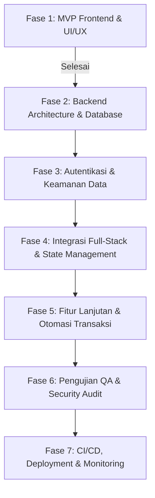

# 📋 FinTrack Product & Engineering Backlog (End-to-End)

Dokumen ini memuat peta jalan (*roadmap*), daftar kebutuhan (*backlog*), *user stories*, dan *sprint breakdown* pengembangan aplikasi **FinTrack** dari tahap fondasi awal (*MVP Frontend*) hingga tahap produksi (*Enterprise-ready Full-stack*).

---

## 🎯 Visi & Metrik Produk

- **Visi Produk**: Menjadi platform pelacak dan perencana keuangan pribadi yang intuitif, cepat, visual, dan aman bagi pengguna di Indonesia.
- **Standar Metrik Sukses**:
  - Waktu pencatatan transaksi < 10 detik.
  - Akurasi perhitungan saldo dan laporan kas 100%.
  - Ketersediaan sistem (*Uptime*) ≥ 99.9%.

---

## 🏷️ Matriks Prioritas (MoSCoW)

| Kategori | Deskripsi | Komponen Utama |
|---|---|---|
| **Must Have** | Wajib ada agar aplikasi dapat berfungsi sebagai pelacak keuangan. | Auth, CRUD Transaksi, Kategori, Saldo Dompet, Dashboard Kas, Penyimpanan Data |
| **Should Have** | Sangat penting untuk nilai guna dan kenyamanan pengguna. | Manajemen Anggaran (Budgeting), Analisis 50/30/20, Ekspor CSV/PDF, Filter & Sortir Dinamis |
| **Could Have** | Nilai tambah yang meningkatkan daya saing (*competitive advantage*). | OCR Struk/Nota, Transaksi Berulang (*Recurring*), Notifikasi Peringatan Budget |
| **Won't Have (v1)** | Ditunda untuk fase rilis berikutnya setelah v1 stabil. | Multi-mata uang real-time, integrasi langsung API Open Banking BI-FAST |

---

## 🗺️ Roadmap & Fase Pengembangan



---

## 📦 Rincian Backlog per Epic

### EPIC 1: Fondasi UI/UX & Prototipe Frontend (Client MVP)
> **Status: [X] Selesai (Completed)**

| ID | User Story / Task | Prioritas | Estimasi | Status | Acceptance Criteria |
|---|---|:---:|:---:|:---:|---|
| **FE-01** | Setup Vite + React 19 + Lucide Icons + Recharts | P1 | 2 pts | **[X] DONE** | Build sukses, tidak ada error resolusi modul, struktur direktori teratur. |
| **FE-02** | Desain Sistem Desain Vanilla CSS & Palet Warna | P1 | 3 pts | **[X] DONE** | Tampilan modern, responsif desktop/mobile, variabel token CSS terdefinisi. |
| **FE-03** | Komponen Sidebar & Navigasi Antar Halaman | P1 | 2 pts | **[X] DONE** | Active state jelas, drawer collapsible di mobile, informasi saldo preview. |
| **FE-04** | Header Dinamis & Trigger Quick Action | P2 | 1 pt | **[X] DONE** | Menampilkan tanggal lokal ID, judul halaman dinamis, tombol modal catat transaksi. |
| **FE-05** | Form Modal Catat Transaksi Baru | P1 | 3 pts | **[X] DONE** | Tab pemasukan/pengeluaran, format Rupiah interaktif, validasi input nominal > 0. |
| **FE-06** | Dashboard Finansial & Visualisasi Grafik | P1 | 5 pts | **[X] DONE** | 4 KPI stat cards, AreaChart tren arus kas, PieChart donat alokasi kategori. |
| **FE-07** | Halaman Riwayat Transaksi Lengkap | P1 | 3 pts | **[X] DONE** | Filter tipe, filter kategori, fitur live search, dan pengurutan (sorting). |
| **FE-08** | Halaman Laporan & Evaluasi Rasio 50/30/20 | P2 | 3 pts | **[X] DONE** | Menghitung rasio kebutuhan vs keinginan vs tabungan, tabel progress bar pos. |
| **FE-09** | Halaman Manajemen Anggaran (Budgeting) | P2 | 3 pts | **[X] DONE** | Plafon anggaran per kategori dengan status Aman/Waspada/Over Limit, inline edit. |
| **FE-10** | Halaman Pengaturan & Ekspor/Impor JSON | P3 | 2 pts | **[X] DONE** | Backup JSON, restore JSON, reset default sample data, simpan profil dasar. |


---

### EPIC 2: Arsitektur Backend & Database (Core Engine)
> **Status: 📝 To Do**

| ID | User Story / Task | Prioritas | Estimasi | Status | Acceptance Criteria |
|---|---|:---:|:---:|:---:|---|
| **BE-01** | Desain ERD & Skema Database Relasional (PostgreSQL/MySQL) | P1 | 3 pts | 📋 TODO | Skema mencakup tabel `users`, `wallets`, `categories`, `transactions`, `budgets`. Relasi foreign key, indexing indeks tanggal & user_id. |
| **BE-02** | Inisialisasi Project Backend (Node.js/Express atau Golang) | P1 | 2 pts | 📋 TODO | Setup boilerplate, linting, environment variables (`.env`), CORS, logger middleware. |
| **BE-03** | Setup Database Migration & ORM (Prisma / Drizzle / GORM) | P1 | 3 pts | 📋 TODO | Migrasi tabel berjalan otomatis, seed data awal kategori default. |
| **BE-04** | API Endpoint CRUD Transaksi (`/api/v1/transactions`) | P1 | 5 pts | 📋 TODO | Endpoint GET (dengan paginasi, filter, search), POST, PUT, DELETE. Validasi payload ketat. |
| **BE-05** | API Endpoint Dompet/Rekening (`/api/v1/wallets`) | P1 | 3 pts | 📋 TODO | CRUD rekening/dompet, endpoint transfer dana antar rekening secara atomik (*transaction block*). |
| **BE-06** | API Endpoint Kategori (`/api/v1/categories`) | P2 | 2 pts | 📋 TODO | List default kategori + kemampuan pengguna membuat kategori kustom. |
| **BE-07** | API Endpoint Anggaran (`/api/v1/budgets`) | P2 | 3 pts | 📋 TODO | Set/update target anggaran per bulan dan per kategori. |
| **BE-08** | API Endpoint Analitik & Laporan (`/api/v1/analytics`) | P2 | 5 pts | 📋 TODO | Mengembalikan agregat ringkasan saldo, tren per bulan, dan distribusi pengeluaran. |

---

### EPIC 3: Autentikasi & Keamanan Multi-Tenant
> **Status: 📝 To Do**

| ID | User Story / Task | Prioritas | Estimasi | Status | Acceptance Criteria |
|---|---|:---:|:---:|:---:|---|
| **SEC-01** | Autentikasi Pengguna (Registrasi & Login) | P1 | 5 pts | 📋 TODO | Password di-hash menggunakan Argon2 atau Bcrypt (salt rounds 10+). Validasi format email & password kuat. |
| **SEC-02** | Token Management (JWT Access & Refresh Token) | P1 | 3 pts | 📋 TODO | Access token berumur pendek (15m), refresh token tersimpan di HttpOnly Secure Cookie. |
| **SEC-03** | Middleware Proteksi Rute & Isolasi Data (*Data Isolation*) | P1 | 3 pts | 📋 TODO | Pengguna hanya dapat membaca dan mengubah data miliknya sendiri (`WHERE user_id = current_user`). |
| **SEC-04** | Fitur Lupa Password & Verifikasi Email | P2 | 3 pts | 📋 TODO | Kirim tautan reset password berbatas waktu (1 jam) via SMTP (Resend/SendGrid). |
| **SEC-05** | Rate Limiting & Proteksi Brute Force | P2 | 2 pts | 📋 TODO | Pembatasan request login (maks 5 percobaan gagal per IP/menit) menggunakan Redis/in-memory limiter. |

---

### EPIC 4: Integrasi Frontend ke Backend (Full-Stack Bridge)
> **Status: 📝 To Do**

| ID | User Story / Task | Prioritas | Estimasi | Status | Acceptance Criteria |
|---|---|:---:|:---:|:---:|---|
| **INT-01** | Setup HTTP Client & Axios Interceptor | P1 | 2 pts | 📋 TODO | Auto-inject Bearer Token di header, auto-refresh token saat respon 401 Unauthorized. |
| **INT-02** | Migrasi State Management ke TanStack Query (React Query) | P1 | 5 pts | 📋 TODO | Caching otomatis, background revalidation, optimistic updates pada transaksi baru. |
| **INT-03** | Halaman Login, Register, & Forgot Password di Frontend | P1 | 3 pts | 📋 TODO | Tampilan antarmuka login responsif, feedback validasi error formulir yang jelas. |
| **INT-04** | Global Error & Loading Skeleton States | P2 | 2 pts | 📋 TODO | Tampilan shimmer/skeleton saat loading data grafik & tabel, toast notifikasi sukses/gagal. |

---

### EPIC 5: Fitur Lanjutan & Otomasi Transaksi
> **Status: 📝 To Do**

| ID | User Story / Task | Prioritas | Estimasi | Status | Acceptance Criteria |
|---|---|:---:|:---:|:---:|---|
| **ADV-01** | Transaksi Berulang (*Recurring Transactions*) | P2 | 5 pts | 📋 TODO | Pengguna dapat menandai transaksi bulanan (contoh: gaji, langganan internet). Cron job mencatat mutasi otomatis sesuai jadwal. |
| **ADV-02** | Fitur Transfer Antar Rekening | P2 | 3 pts | 📋 TODO | Form transfer dari Rekening A ke Rekening B (mengurangi saldo A, menambah saldo B, biaya admin opsional). |
| **ADV-03** | Ekspor Laporan ke Format PDF Berformat Resmi | P3 | 3 pts | 📋 TODO | Mengunduh lembar laporan bulanan berformat rapi dengan kop dan grafik ringkasan. |
| **ADV-04** | Peringatan Melebihi Anggaran (*Budget Alert*) | P2 | 3 pts | 📋 TODO | Notifikasi dalam aplikasi atau via email jika pengeluaran kategori mencapai ≥ 80% dan 100%. |
| **ADV-05** | Smart Receipt Scanner (OCR Struk Belanja) | P3 | 8 pts | 📋 TODO | Upload foto struk kasir, sistem mengekstrak total nominal, tanggal, dan nama toko secara otomatis via AI/OCR. |

---

### EPIC 6: Pengujian Kualitas (QA) & Audit Keamanan
> **Status: 📝 To Do**

| ID | User Story / Task | Prioritas | Estimasi | Status | Acceptance Criteria |
|---|---|:---:|:---:|:---:|---|
| **QA-01** | Unit Testing Komponen Kritis & Formula Finansial | P1 | 3 pts | 📋 TODO | Formula saldo, agregat per kategori, dan format Rupiah memiliki coverage tes 100%. |
| **QA-02** | Integration Testing Endpoint REST API | P1 | 5 pts | 📋 TODO | Pengujian skenario CRUD transaksi, autentikasi, dan validasi menggunakan Jest/Supertest atau Postman. |
| **QA-03** | E2E Testing Alur Kritis Pengguna (Playwright/Cypress) | P2 | 5 pts | 📋 TODO | Simulasi alur: Registrasi -> Login -> Tambah Transaksi -> Cek Perubahan Saldo di Dashboard. |
| **QA-04** | Audit Keamanan OWASP Top 10 | P1 | 3 pts | 📋 TODO | Bebas celah SQL Injection, XSS, CSRF, dan kebocoran data sensitif (*sensitive data exposure*). |

---

### EPIC 7: Deployment, CI/CD & Pemeliharaan
> **Status: 📝 To Do**

| ID | User Story / Task | Prioritas | Estimasi | Status | Acceptance Criteria |
|---|---|:---:|:---:|:---:|---|
| **OPS-01** | Kontainerisasi Docker (Frontend & Backend) | P2 | 3 pts | 📋 TODO | `Dockerfile` multi-stage build yang ringan dan `docker-compose.yml` untuk lingkungan lokal & staging. |
| **OPS-02** | Setup Otomasi CI/CD Pipeline (GitHub Actions) | P1 | 3 pts | 📋 TODO | Linting dan pengujian otomatis berjalan setiap ada Pull Request ke branch `main`. |
| **OPS-03** | Deployment Produksi (Vercel / Cloudflare + Railway / Render) | P1 | 3 pts | 📋 TODO | Frontend online dengan custom domain & SSL HTTPS, database terkelola dengan auto-backup harian. |
| **OPS-04** | Integrasi Error Monitoring & Telemetry (Sentry) | P2 | 2 pts | 📋 TODO | Error log dari runtime browser dan server langsung terlaporkan ke dashboard Sentry. |

---

## 🏃 Rencana Pembagian Sprint (Sprint Plan)

```
Sprint 1 (Minggu 1-2) : Setup Client MVP (Selesai ✅)
Sprint 2 (Minggu 3-4) : Backend Architecture, Database Schema, & Core Transaction CRUD
Sprint 3 (Minggu 5-6) : User Authentication, Security Hardening, & Multi-tenant Isolation
Sprint 4 (Minggu 7-8) : Frontend-Backend Integration, TanStack Query, & Auth Pages
Sprint 5 (Minggu 9-10): Advanced Budgeting, Alerts, Recurring Transactions, & PDF Export
Sprint 6 (Minggu 11-12): End-to-End Testing, Bug Fixes, CI/CD Pipeline, & Production Release
```

---

## 🏁 Definition of Done (DoD)

Sebuah tugas/tiket dinyatakan **DONE** apabila memenuhi kriteria berikut:
1. **Fungsional**: Fitur berfungsi sesuai *Acceptance Criteria* tanpa error di konsol.
2. **Kualitas Kode**: Kode bersih, mengikuti standar penamaan yang konsisten, tidak ada *hardcoded credentials*.
3. **Responsif**: Tampilan berjalan mulus di resolusi desktop (≥ 1280px), tablet (768px - 1024px), dan ponsel (≤ 480px).
4. **Teruji**: Melewati pengujian manual dan tes otomatis terkait tanpa *regression bug*.
5. **Dokumentasi**: Perubahan fungsi atau API didokumentasikan di file `README.md` atau dokumentasi API terkait.
