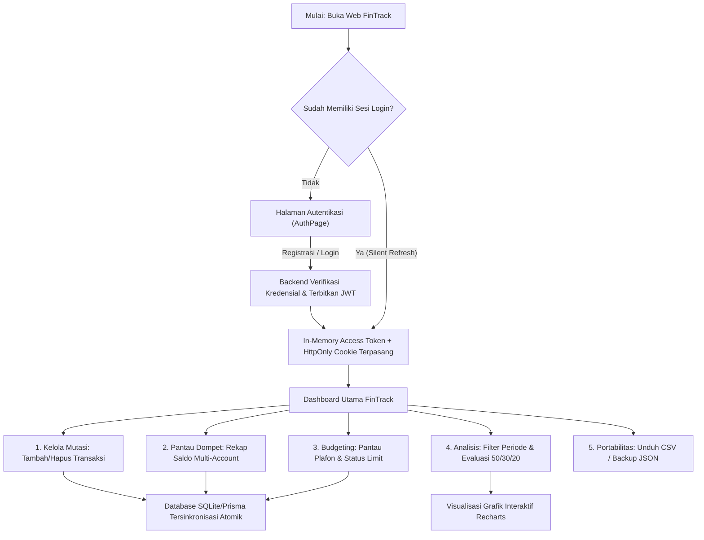
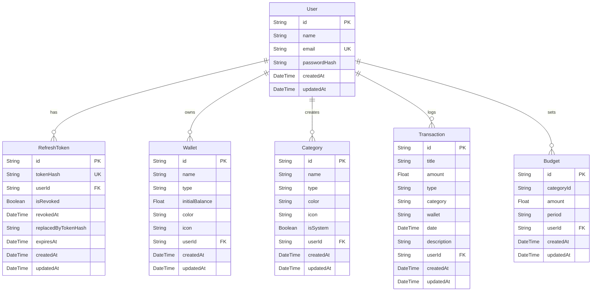

# 📑 Product Requirement Document (PRD) — FinTrack
**Sistem Manajemen & Analitik Keuangan Personal (Full-Stack Web Application)**

---

## 📌 1. Kontrol Dokumen & Metadata

| Atribut | Informasi |
|---|---|
| **Nama Produk** | **FinTrack** (*Smart Personal Finance & Cashflow Tracking*) |
| **Versi Dokumen** | `v1.2.0 (Production-Ready Architecture)` |
| **Status Dokumen** | **Disetujui / Aktif (Approved for Implementation)** |
| **Pemilik Produk (Product Owner)** | Tim Rekayasa Perangkat Lunak FinTrack |
| **Tech Stack Utama** | React 19 (Vite Bundler), Node.js, Express.js, Prisma ORM, SQLite / PostgreSQL |
| **Target Rilis** | Q4 2026 |
| **Dokumen Terkait** | [`SPRINT_30_DAYS.md`](file:///d:/month-4/project-keuwangan/fintrack/SPRINT_30_DAYS.md), [`DEPLOYMENT.md`](file:///d:/month-4/project-keuwangan/DEPLOYMENT.md), [`BACKEND_PROGRESS.md`](file:///d:/month-4/project-keuwangan/BACKEND_PROGRESS.md) |

---

## 🎯 2. Ringkasan Eksekutif & Visi Produk

### 2.1 Latar Belakang Masalah (Problem Statement)
Mengelola keuangan pribadi di era digital saat ini semakin kompleks. Individu sering menghadapi tantangan berikut:
1. **Fragmentasi Rekening & Saldo**: Pengguna memiliki saldo yang tersebar di berbagai rekening bank, dompet digital (GoPay, OVO, ShopeePay), dan uang tunai tanpa adanya satu dashboard agregator terpadu.
2. **Ketiadaan Disiplin Anggaran (Budgeting Blind Spots)**: Pengeluaran seringkali tidak terdeteksi hingga saldo habis karena tidak adanya peringatan dini (*budget limits*) per kategori beban.
3. **Kalkulasi Kesehatan Finansial yang Tidak Baku**: Jarang sekali aplikasi finansial menyediakan evaluasi otomatis berdasarkan standar perencanaan finansial teruji seperti **Aturan 50 / 30 / 20**.
4. **Kekhawatiran Privasi & Keamanan Data Kredensial**: Banyak aplikasi pihak ketiga menyimpan kredensial pada penyimpanan lokal yang rentan terhadap serangan XSS (Cross-Site Scripting) atau tidak menyediakan mekanisme cadangan data independen (*data portability*).

### 2.2 Visi & Proposisi Nilai (Value Proposition)
> **FinTrack** hadir sebagai aplikasi web manajemen keuangan personal berkecepatan tinggi, aman (*bank-grade security architecture*), dan cerdas. FinTrack menyatukan pencatatan mutasi multi-rekening harian, pengawasan batas anggaran real-time, visualisasi grafik interaktif, dan evaluasi kesehatan finansial 50/30/20 ke dalam satu sistem yang responsif di perangkat mobile maupun desktop.

### 2.3 Sasaran Kunci Produk (Product Goals)
- **Zero-Friction Logging**: Mencatat mutasi keuangan harian dalam waktu kurang dari 5 detik dengan preview Rupiah instan.
- **Accurate Real-Time Liquidity**: Mengkalkulasi likuiditas riil dari seluruh dompet secara dinamis tanpa inkonsistensi data (*no double-counting*).
- **Proactive Budget Monitoring**: Memberikan indikasi status anggaran kategori (Aman, Waspada ≥80%, Terlampaui >100%) sebelum terjadi pemborosan dana.
- **Robust Security by Design**: Menerapkan arsitektur autentikasi ganda (JWT Access Token in-memory + HttpOnly Refresh Token RFC 6749), proteksi CSRF, dan sanitasi ekspor CSV dari celah formula injection (CWE-1236).

---

## 👥 3. Target Pengguna & Persona

```
+----------------------------------------------------------------------------------------------------+
|                                      PERSONA PENGGUNA FINTRACK                                     |
+----------------------------------+----------------------------------+------------------------------+
| Rian (23 Tahun)                  | Sarah (29 Tahun)                 | Hendra (35 Tahun)            |
| Fresh Graduate / Junior Engineer | Assistant Marketing Manager      | Freelancer / Pemilik UMKM    |
+----------------------------------+----------------------------------+------------------------------+
| Fokus: Pencatatan mutasi harian, | Fokus: Evaluasi rasio tabungan,  | Fokus: Pemisahan rekening    |
| tracking pengeluaran kopi/makan, | alokasi Aturan 50/30/20, kontrol | bisnis vs pribadi, ekspor    |
| mengawasi saldo e-Wallet.        | plafon belanja bulanan.          | laporan mutasi ke CSV/Excel. |
+----------------------------------+----------------------------------+------------------------------+
```

### 3.1 Persona 1: Rian (23 th, Fresh Graduate)
- **Tujuan**: Mengetahui ke mana uang gajinya habis setiap bulan dan memastikan uang tunai serta saldo e-wallet selalu sinkron.
- **Kendala**: Sering lupa mencatat pengeluaran kecil; malas menggunakan aplikasi perbankan yang lambat dan penuh iklan.
- **Kebutuhan**: Form input transaksi yang cepat, responsif di ponsel, serta kartu ringkasan saldo cepat di sidebar.

### 3.2 Persona 2: Sarah (29 th, Profesional Karir)
- **Tujuan**: Menerapkan metode budgeting yang disiplin (membatasi gaya hidup maks 30%) dan memaksimalkan rasio tabungan tahunan.
- **Kendala**: Sulit menghitung manual alokasi kebutuhan pokok vs keinginan setiap akhir bulan.
- **Kebutuhan**: Halaman Laporan interaktif dengan kalkulator 50/30/20 otomatis, grafik tren arus kas bulanan, dan badge indikator over-budget.

### 3.3 Persona 3: Hendra (35 th, Freelancer / Solopreneur)
- **Tujuan**: Mengatur arus kas pendapatan yang fluktuatif serta memisahkan rekening operasional kerja dari rekening belanja keluarga.
- **Kendala**: Takut data keuangan bocor ke pihak ketiga; butuh cadangan berkas transaksi yang bisa diolah kembali di spreadsheet.
- **Kebutuhan**: Fitur multi-wallet (Bank BCA, Mandiri, Cash), unduh cadangan data JSON atomik, dan ekspor riwayat mutasi ke berkas CSV yang aman dari formula injection.

---

## 🗺️ 4. Alur Kerja Pengguna (User Journeys & Workflow)



---

## ⚙️ 5. Spesifikasi Kebutuhan Fungsional (Functional Requirements)

### Modul 1: Autentikasi & Manajemen Sesi (FR-AUTH)
- **FR-AUTH-01 (Registrasi Akun)**: Pengguna dapat mendaftarkan akun baru dengan memasukkan Nama Lengkap, Alamat Email valid, dan Password (minimal 6 karakter). Email harus unik di database.
- **FR-AUTH-02 (Hashing Kredensial)**: Password wajib di-hash menggunakan algoritma **Bcrypt** dengan salt round minimal 10 sebelum disimpan ke database. Hash password tidak boleh dikembalikan pada payload API.
- **FR-AUTH-03 (Login Pengguna)**: Pengguna dapat login menggunakan kombinasi email dan password yang valid. Keberhasilan login mengembalikan profil pengguna, *in-memory Access Token* (masa aktif 15 menit), serta memasang cookie *HttpOnly Refresh Token* (masa aktif 7 hari).
- **FR-AUTH-04 (Rotasi Token RFC 6749)**: Setiap pemanggilan endpoint `POST /api/auth/refresh` wajib memvalidasi token refresh lama, mencabutnya (*revocation*), dan menerbitkan token refresh baru (*rotation*). Jika token yang telah dicabut digunakan kembali, sistem wajib mendeteksi pencurian sesi (*reuse detection*) dan mencabut seluruh sesi pengguna.
- **FR-AUTH-05 (Logout Aman)**: Endpoint `POST /api/auth/logout` mencabut sesi di database, menghapus cookie `fintrack_refresh_token`, dan mengosongkan state auth pada memori klien.
- **FR-AUTH-06 (Quick Demo Login)**: Tersedia tombol login demo cepat di antarmuka frontend untuk memudahkan peninjau/auditor menguji aplikasi tanpa registrasi manual.

### Modul 2: Manajemen Akun Rekening / Dompet (FR-WALLET)
- **FR-WALLET-01 (Multi-Wallet Support)**: Pengguna dapat membuat beberapa rekening/dompet keuangan dengan tipe: `Bank`, `Cash` (Tunai), `e-Wallet`, atau `Investasi`.
- **FR-WALLET-02 (Saldo Awal / Initial Balance)**: Setiap dompet memiliki atribut `initialBalance` (angka non-negatif) yang menjadi saldo dasar saat pembukaan rekening.
- **FR-WALLET-03 (Kalkulasi Saldo Dinamis)**: Saldo riil setiap dompet dikalkulasi secara *real-time* berbasis formula:
  $$\text{Saldo Dompet} = \text{InitialBalance} + \sum \text{Pemasukan Dompet} - \sum \text{Pengeluaran Dompet}$$
- **FR-WALLET-04 (Proteksi Integritas Hapus)**: Sistem wajib menolak penghapusan dompet yang masih memiliki mutasi transaksi terhubung (HTTP 400 Bad Request) demi mencegah inkonsistensi saldo historis.
- **FR-WALLET-05 (Kustomisasi Visual)**: Setiap dompet dapat diberikan warna tema khusus dan ikon representatif.

### Modul 3: Manajemen Kategori Finansial (FR-CAT)
- **FR-CAT-01 (Kategori Sistem Bawaan)**: Sistem menyediakan kategori default (Makanan & Minuman, Transportasi, Belanja, Tagihan & Utilitas, Hiburan, Kesehatan, Pendidikan, Gaji Pokok, Bonus, Investasi).
- **FR-CAT-02 (Kategori Kustom Pengguna)**: Pengguna dapat menambahkan kategori kustom pribadi sesuai kebutuhan operasional.
- **FR-CAT-03 (Proteksi Kategori Sistem)**: Kategori dengan tanda `isSystem: true` dilindungi secara ketat dari upaya modifikasi atau penghapusan (HTTP 403 Forbidden).

### Modul 4: Manajemen Transaksi Finansial (FR-TX)
- **FR-TX-01 (Pencatatan Pemasukan & Pengeluaran)**: Pengguna dapat mencatat mutasi keuangan dengan memilih jenis (*Expense* / *Income*), judul transaksi, nominal (> 0), tanggal transaksi, kategori, dompet sumber, dan catatan deskripsi opsional.
- **FR-TX-02 (Live Rupiah Preview)**: Form input transaksi wajib menampilkan preview teks Rupiah terformat secara instan saat pengguna mengetik angka nominal.
- **FR-TX-03 (Update Transaksi)**: Pengguna dapat memperbarui rincian transaksi (judul, nominal, dompet, tanggal, kategori). Saldo dompet terkait otomatis disesuaikan ulang.
- **FR-TX-04 (Hapus Transaksi)**: Pengguna dapat menghapus transaksi dengan dialog konfirmasi awal untuk mencegah ketidaksengajaan.

### Modul 5: Riwayat, Filter & Pencarian Mutasi (FR-HISTORY)
- **FR-HISTORY-01 (Pencarian Teks Real-Time)**: Pencarian cepat berbasis kata kunci pada judul mutasi maupun catatan tambahan.
- **FR-HISTORY-02 (Filter Multidimensi)**: Filter berdasarkan jenis mutasi (Semua, Pemasukan, Pengeluaran), filter per kategori, dan filter per dompet.
- **FR-HISTORY-03 (Pengurutan Fleksibel)**: Opsi pengurutan data: Terbaru, Terlama, Nominal Tertinggi, dan Nominal Terendah.
- **FR-HISTORY-04 (Paginasi Data Backend)**: Dukungan pagination pada endpoint `/api/transactions` untuk performa query database yang efisien.

### Modul 6: Manajemen Batas Anggaran / Budgeting (FR-BUDGET)
- **FR-BUDGET-01 (Penetapan Plafon Bulanan)**: Pengguna dapat menetapkan batas maksimal pengeluaran bulanan per pos kategori pengeluaran.
- **FR-BUDGET-02 (Indikator Status Anggaran)**: Sistem secara otomatis mengklasifikasikan status anggaran:
  - **Aman**: Realisasi pengeluaran < 80% dari plafon.
  - **Waspada**: Realisasi pengeluaran berada di antara 80% s/d 100%.
  - **Over Limit / Terlampaui**: Realisasi pengeluaran melebihi 100% dari plafon.
- **FR-BUDGET-03 (Inline Quick Edit)**: Pengguna dapat mengedit plafon anggaran secara langsung dari kartu anggaran tanpa membuka modal dialog terpisah.

### Modul 7: Dashboard Eksekutif & Visualisasi Grafik (FR-DASH)
- **FR-DASH-01 (5 Kartu Metrik Utama)**:
  1. *Total Saldo Seluruh Dompet* (Total likuiditas riil bersih *lifetime*).
  2. *Total Pemasukan* (Akumulasi dana masuk pada periode terpilih).
  3. *Total Pengeluaran* (Akumulasi beban keluar pada periode terpilih).
  4. *Arus Kas Bersih & Savings Rate* (Net cashflow dan persentase rasio tabungan).
  5. *Sisa Plafon Anggaran & Counter Over-Budget* (Sisa batas belanja dan jumlah pos yang terlampaui).
- **FR-DASH-02 (Filter Periode Waktu Fleksibel)**:
  - *Bulan Ini (`this_month`)*: Tanggal 1 s/d akhir bulan aktif.
  - *Bulan Lalu (`last_month`)*: Rentang penuh bulan sebelumnya.
  - *3 Bulan Terakhir (`last_3_months`)*: Tiga bulan kalender terakhir.
  - *Rentang Khusus (`custom`)*: Pemilih tanggal manual dengan validasi tanggal terbalik (`startDate <= endDate`).
- **FR-DASH-03 (Grafik Tren Arus Kas - Recharts AreaChart)**: Visualisasi tren pemasukan vs pengeluaran dengan tombol toggle tampilan **Bulanan** (6 bulan terakhir) vs **Harian** (dalam periode aktif).
- **FR-DASH-04 (Grafik Donut Alokasi Pengeluaran - Recharts PieChart)**: Diagram donat pembagian pos pengeluaran dengan nominal total di bagian tengah dan rincian persentase per kategori.
- **FR-DASH-05 (Ranking Kategori Pengeluaran Terbesar)**: Daftar peringkat kategori dengan pengeluaran tertinggi dilengkapi bilah progres visual dan label peringatan jika over-budget.

### Modul 8: Laporan Analisis Keuangan 50/30/20 (FR-REP)
- **FR-REP-01 (Kalkulator Formula 50/30/20)**:
  - **Kebutuhan Pokok (Needs - Target 50%)**: Makanan, Transportasi, Tagihan, Kesehatan, Pendidikan.
  - **Keinginan / Gaya Hidup (Wants - Target 30%)**: Belanja, Hiburan, Rekreasi.
  - **Tabungan & Investasi (Savings - Target 20%)**: Sisa arus kas bersih surplus atau kategori investasi.
- **FR-REP-02 (Status Evaluasi Finansial)**: Memberikan rekomendasi evaluasi apakah alokasi belanja pengguna tergolong Sehat, Waspada, atau Berisiko.

### Modul 9: Portabilitas & Cadangan Data (FR-DATA)
- **FR-DATA-01 (Ekspor CSV Anti Formula Injection)**: Pengguna dapat mengunduh seluruh transaksi ke format CSV. Kolom yang diawali karakter eksekusi formula spreadsheet (`=`, `+`, `-`, `@`) wajib ditambahkan kutip satu (*escaping prefix*) guna mencegah eksploitasi **CWE-1236**.
- **FR-DATA-02 (Unduh Cadangan JSON Atomik)**: Ekspor seluruh data akun (profil, dompet, transaksi, kategori, anggaran) ke dalam satu berkas cadangan JSON terenkapsulasi tanpa menyertakan hash password.
- **FR-DATA-03 (Pemulihan Data JSON)**: Pengguna dapat mengimpor berkas cadangan JSON untuk memulihkan seluruh data secara atomik menggunakan transaksi Prisma (`prisma.$transaction`).

### Modul 10: Fitur Lanjutan Masa Depan (FR-FUTURE)
- **FR-FUTURE-01 (Mutasi Berulang / Recurring)**: Otomatisasi pencatatan mutasi rutin mingguan/bulanan melalui penjadwalan cron job backend.
- **FR-FUTURE-02 (Transfer Antar Rekening)**: Modal transaksi khusus untuk memindahkan saldo dari Dompet A ke Dompet B tanpa mengubah saldo bersih agregat.
- **FR-FUTURE-03 (Ekspor Laporan PDF Resmi)**: Pembuatan dokumen rekapitulasi keuangan formal berformat PDF siap cetak.
- **FR-FUTURE-04 (Ekstraksi Struk Kasir OCR)**: Pengunggahan foto struk belanja untuk dipindai otomatis menjadi draf transaksi.

---

## 🔒 6. Kebutuhan Non-Fungsional (Non-Functional Requirements)

### 6.1 Keamanan & Privasi (Security & Privacy)
- **NFR-SEC-01 (In-Memory Access Token)**: Access token JWT **dilarang keras** disimpan pada `localStorage` atau `sessionStorage` untuk mengeliminasi risiko pencurian token melalui script injection (XSS).
- **NFR-SEC-02 (HttpOnly Refresh Cookies)**: Refresh token wajib disimpan di cookie dengan atribut `HttpOnly`, `SameSite=Lax` (atau `None` jika lintas-domain HTTPS), dan `Secure=true` di lingkungan produksi.
- **NFR-SEC-03 (CSRF Defense)**: Menerapkan mekanisme *Double-Submit Cookie* dengan token CSRF (`X-CSRF-Token`) pada seluruh mutasi HTTP bersandi cookie.
- **NFR-SEC-04 (Isolasi Data Multi-Tenant)**: Seluruh operasi query database wajib menyertakan filter `userId: req.user.id` yang tervalidasi dari token JWT guna mencegah kerentanan IDOR (*Insecure Direct Object Reference*).
- **NFR-SEC-05 (Mitigasi Formula Injection CWE-1236)**: Seluruh field teks pada ekspor CSV wajib disanitasi dari prefix formula spreadsheet berbahaya.

### 6.2 Performa & Skalabilitas (Performance)
- **NFR-PERF-01 (Waktu Respons API)**: 95% permintaan REST API wajib direspons dalam waktu kurang dari 150 milidetik pada beban normal.
- **NFR-PERF-02 (Bundle Chunk Splitting)**: Bundel frontend Vite dioptimalkan dengan pemisahan chunk vendor (`vendor-react`, `vendor-charts`, `vendor-icons`), menjaga ukuran berkas individual tetap di bawah 400 kB gzipped.
- **NFR-PERF-03 (Waktu Pemuatan Aplikasi)**: Target *First Contentful Paint (FCP)* < 1.2 detik dan *Time to Interactive (TTI)* < 2.0 detik pada jaringan 4G standar.

### 6.3 Keandalan & Integritas Data (Reliability)
- **NFR-REL-01 (Atomic Database Operations)**: Seluruh operasi yang melibatkan perubahan multi-tabel (seperti restore data atau penghapusan pengguna) wajib dibungkus dalam Prisma Database Transaction.
- **NFR-REL-02 (Target Ketersediaan)**: Sistem dirancang untuk mencapai *uptime* operasional minimal 99.9%.
- **NFR-REL-03 (Automated Test Pass)**: Basis kode backend wajib mempertahankan kelulusan 100% pada rangkaian pengujian otomatis (minimal 268 assertions aktif).

### 6.4 Usabilitas & Aksesibilitas (Usability & Design)
- **NFR-UX-01 (Desain Sistem Modern)**: Antarmuka dibangun dengan sistem Vanilla CSS modern (*soft shadows*, kontras tipografi Plus Jakarta Sans, kartu berbingkai halus, dan palet warna finansial terstandar).
- **NFR-UX-02 (Responsif Desktop & Mobile)**: Tampilan desktop menggunakan *sticky sidebar*, sementara tampilan mobile memanfaatkan *collapsible drawer* dan panel kartu yang dapat di-scroll vertikal secara natural.
- **NFR-UX-03 (Format Moneter & Lokalisasi)**: Seluruh nominal moneter disajikan dalam format mata uang Rupiah (`Rp 1.500.000`) dan penanggalan berbahasa Indonesia.

---

## 🏛️ 7. Arsitektur Sistem & Model Data (ERD)

### 7.1 Diagram Arsitektur Komponen
```
+-----------------------------------------------------------------------------------------+
|                                    KLIEN (FRONTEND)                                     |
|  - React 19 SPA (Vite Bundler + Code Splitting)                                         |
|  - In-Memory Access Token Storage                                                       |
|  - State Management: FinanceContext & useFinance Hook                                   |
|  - Komponen Visual: Recharts (AreaChart, PieChart) + Lucide Icons                        |
+--------------------------------------------+--------------------------------------------+
                                             |
                                  HTTPS + Cookie Kredensial
                                  Header: Authorization + X-CSRF-Token
                                             |
                                             v
+-----------------------------------------------------------------------------------------+
|                                  SERVER BACKEND (API)                                   |
|  - Node.js & Express.js REST API Server                                                 |
|  - Middlewares: Security Headers, CORS Whitelist, Cookie Parser, CSRF, requireAuth      |
|  - Controllers: Auth, Wallet, Category, Transaction, Budget, Analytics, Data Backup      |
+--------------------------------------------+--------------------------------------------+
                                             |
                                       Prisma ORM Client
                                             |
                                             v
+-----------------------------------------------------------------------------------------+
|                                   DATABASE PERSISTEN                                    |
|  - SQLite (Development / Standalone Persistent Disk)                                    |
|  - PostgreSQL (Cloud Managed Production Database: Supabase / Railway / Neon)             |
+-----------------------------------------------------------------------------------------+
```

### 7.2 Entity Relationship Diagram (ERD)



---

## 🌐 8. Matriks Spesifikasi REST API

Seluruh endpoint terproteksi wajib menyertakan header: `Authorization: Bearer <accessToken>`.

| Modul | Method | Endpoint | Deskripsi | Proteksi |
|---|:---:|---|---|:---:|
| **Health** | `GET` | `/api/health` | Status kesiapan server & database | Publik |
| **Auth** | `POST` | `/api/auth/register` | Pendaftaran akun baru | Publik |
| **Auth** | `POST` | `/api/auth/login` | Login & penerbitan token | Publik |
| **Auth** | `POST` | `/api/auth/refresh` | Rotasi token refresh sesi | Cookie HttpOnly |
| **Auth** | `POST` | `/api/auth/logout` | Pencabutan sesi & penghapusan cookie | Terproteksi |
| **Auth** | `GET` | `/api/auth/me` | Profil pengguna aktif | Terproteksi |
| **Wallets** | `GET` | `/api/wallets` | Ambil daftar dompet pengguna | Terproteksi |
| **Wallets** | `POST` | `/api/wallets` | Tambah dompet rekening baru | Terproteksi |
| **Wallets** | `PUT` | `/api/wallets/:id` | Update profil dompet rekening | Terproteksi |
| **Wallets** | `DELETE` | `/api/wallets/:id` | Hapus dompet (ditolak jika ada mutasi) | Terproteksi |
| **Categories** | `GET` | `/api/categories` | Daftar kategori sistem & pengguna | Terproteksi |
| **Categories** | `POST` | `/api/categories` | Tambah kategori kustom | Terproteksi |
| **Categories** | `PUT` | `/api/categories/:id` | Update kategori kustom | Terproteksi |
| **Categories** | `DELETE` | `/api/categories/:id` | Hapus kategori kustom (sistem dilarang) | Terproteksi |
| **Transactions** | `GET` | `/api/transactions` | Query transaksi (search, filter, pagination) | Terproteksi |
| **Transactions** | `POST` | `/api/transactions` | Tambah mutasi pemasukan/pengeluaran | Terproteksi |
| **Transactions** | `GET` | `/api/transactions/:id` | Detail spesifik mutasi | Terproteksi |
| **Transactions** | `PUT` | `/api/transactions/:id` | Update data mutasi | Terproteksi |
| **Transactions** | `DELETE` | `/api/transactions/:id` | Hapus mutasi transaksi | Terproteksi |
| **Budgets** | `GET` | `/api/budgets` | Daftar plafon anggaran aktif | Terproteksi |
| **Budgets** | `POST` | `/api/budgets` | Set / perbarui plafon anggaran bulanan | Terproteksi |
| **Analytics** | `GET` | `/api/analytics/summary` | Agregasi KPI, tren arus kas & ranking beban | Terproteksi |
| **Data Backup** | `GET` | `/api/data/export-csv` | Unduh rekap CSV tersanitasi anti-CWE-1236 | Terproteksi |
| **Data Backup** | `GET` | `/api/data/backup` | Unduh snapshot penuh data JSON | Terproteksi |
| **Data Backup** | `POST` | `/api/data/restore` | Pulihkan data dari snapshot JSON atomik | Terproteksi |

---

## ⚠️ 9. Matriks Penanganan Edge Cases & Pengecualian

| Kasus Khusus (Edge Case) | Dampak Potensial | Solusi Penanganan FinTrack |
|---|---|---|
| **Access Token Habis saat Pengguna Mengisi Form** | Request gagal dengan kode HTTP 401 | Service interceptor `fetchWithAuth` melakukan silent-refresh transparan di balik layar lalu me-replay request tanpa membatalkan input pengguna. |
| **Penghapusan Dompet yang Memiliki Transaksi** | Transaksi kehilangan referensi dan saldo rusak | Endpoint `DELETE /api/wallets/:id` memeriksa ketiadaan transaksi terkait; jika masih ada, request ditolak dengan pesan edukatif. |
| **Percobaan Modifikasi Kategori Sistem** | Struktur kategori baku aplikasi rusak | Controller kategori mengecek flag `isSystem`; jika true, mengembalikan `403 Forbidden`. |
| **Injeksi Karakter Formula CSV (`=CMD\|...`)** | Eksekusi malware pada spreadsheet pengguna | `csvUtils.js` secara otomatis menambahkan prefix kutip satu (`'`) pada data teks berbahaya (Mitigasi CWE-1236). |
| **Konflik Port Dev Lokal (misal 5173 ke 5174)** | Request browser diblokir CORS Backend | Backend menerapkan regex matcher CORS yang mengizinkan seluruh port development `localhost` secara dinamis. |
| **Upload File Cadangan JSON Tidak Valid / Rusak** | Kerusakan integritas data di database | Controller memvalidasi struktur skema data sebelum memulai transaksi Prisma; jika skema salah, seluruh perubahan di-rollback penuh. |

---

## 📈 10. Roadmap Produk & Milestone

```
+-----------------------------------------------------------------------------------------------+
|                                    MILESTONES FINTRACK                                        |
+------------------+------------------+------------------+-------------------+------------------+
| Milestone 1      | Milestone 2      | Milestone 3      | Milestone 4       | Milestone 5      |
| Frontend MVP     | Backend & DB     | Full-Stack & QA  | Security Hardened | Advanced & Cloud |
| (Hari 1 - 10)    | (Hari 11 - 20)   | (Hari 21 - 28)   | (Tahap 8)         | (Tahap Lanjutan) |
| [X] SELESAI      | [X] SELESAI      | [X] SELESAI      | [X] SELESAI       | [ ] UPCOMING     |
+------------------+------------------+------------------+-------------------+------------------+
```

1. **Milestone 1 (Frontend MVP)**: Komponen UI/UX, Recharts visualisasi, state management lokal, dan form transaksi. `[SELESAI]`
2. **Milestone 2 (Backend Engine & Skema Database)**: REST API Express, migrasi skema Prisma, dan sistem autentikasi JWT Bcrypt. `[SELESAI]`
3. **Milestone 3 (Integrasi Full-Stack & Testing)**: Service layer client, Halaman Login/Register, agregasi analitik, dan 268 uji otomatis lulus 100%. `[SELESAI]`
4. **Milestone 4 (Kesiapan Produksi & Hardening)**: Optimasi chunk build Vite, hardening CORS & Cookie, serta panduan lengkap `DEPLOYMENT.md`. `[SELESAI]`
5. **Milestone 5 (Fitur Lanjutan)**: Pencatatan mutasi berulang (*recurring cron*), transfer antar rekening, ekspor PDF resmi, dan pembacaan struk nota kasir OCR. `[DALAM PIPELINE]`
6. **Milestone 6 (DevOps & Peluncuran Cloud)**: Kontainerisasi `Dockerfile` & `docker-compose.yml`, GitHub Actions CI/CD, dan rilis cloud ke Vercel + Render/Railway. `[DALAM PIPELINE]`

---

## 📚 11. Glosarium & Standar Kepatuhan
- **JWT (JSON Web Token)**: Standar terbuka (RFC 7519) untuk transmisi informasi klaim identitas secara aman antara dua pihak.
- **RFC 6749**: Standar resmi OAuth 2.0 yang mengatur praktik terbaik rotasi token penyegar (*Refresh Token Rotation*) dan deteksi penggunaan ulang (*Reuse Detection*).
- **CWE-1236**: *Improper Neutralization of Formula Elements in CSV File*, celah keamanan di mana formula berbahaya dieksekusi oleh aplikasi spreadsheet.
- **IDOR (Insecure Direct Object Reference)**: Kerentanan kontrol akses saat aplikasi menggunakan input yang disediakan pengguna untuk mengakses objek secara langsung.
- **Aturan 50 / 30 / 20**: Rasio alokasi keuangan terkemuka: 50% Kebutuhan Pokok (*Needs*), 30% Keinginan (*Wants*), dan 20% Tabungan/Investasi (*Savings*).
